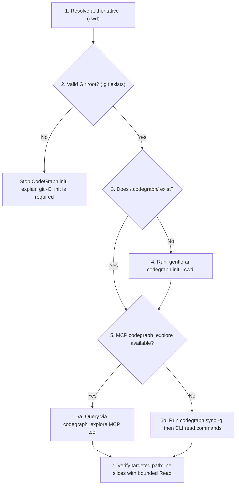

# 🕸️ CodeGraph Intelligence — Structural Codebase & Blast-Radius Analysis

High-precision structural codebase navigation powered by **CodeGraph 1.4.1+** and **Gentle-AI 4.2.0+**. Replaces token-heavy, stochastic `Glob`/`Grep` fishing with deterministic AST call graphs, symbol resolution, caller/callee lineage, and blast-radius impact mapping.

---

## 🚫 Hard Ordering & Lifecycle Invariants

1. **CODEGRAPH BEFORE BROAD FILESYSTEM SEARCH**: For repository maps, architecture, call flows, dependencies, symbol references, impact analysis, and *"how does X work"* questions, check CodeGraph **before** running broad `Read`/`Glob`/`Grep` sweeps.
2. **LAZY INITIALIZATION ON MISSING INDEX**: A missing `<project-root>/.codegraph/` directory in a valid Git repository is the trigger to initialize (`gentle-ai codegraph init --cwd <project-root>`), **never** an excuse to skip CodeGraph.
3. **MANDATORY CLI SYNC BEFORE READS**: The MCP daemon auto-syncs when its watcher is active, but CLI intelligence commands read the index as-is. Always run `codegraph sync -q <project-root>` before CLI queries and after source edits.
4. **NEVER RUN DESTRUCTIVE LIFECYCLE COMMANDS**: Never execute or recommend `codegraph uninit`, `codegraph install`, `codegraph uninstall`, or `codegraph upgrade`. Reserve `codegraph index` strictly for explicit index-corruption recovery.
5. **ISOLATED WORKTREE INDEXES**: Never place CodeGraph-dependent worktrees in `/tmp`, `/var/tmp`, or `/tmp/opencode`. Place them under `<repo-parent>/<repo-name>-worktrees/<worktree-name>`, and never symlink or copy `.codegraph/` across worktrees.

---

## 🧭 The 8-Step Structural Exploration Protocol



### Step-by-Step Execution
1. **Authoritative Root Resolution**: Use the explicit working directory as `<project-root>`. Check `<cwd>/.git` (directory or worktree file) and `<cwd>/.codegraph/` before any ancestor discovery. Never silently fall back to an enclosing parent repository.
2. **Workspace Validation**: Confirm `<project-root>` is a real project repository (never `$HOME`, `/tmp`, or an uninitialized directory).
3. **Lazy Init (Gentle-AI 4.2.0)**: If `.codegraph/` is absent, execute once:
   ```bash
   gentle-ai codegraph init --cwd <project-root>
   ```
   *Note*: In Gentle-AI 4.2.0, `gentle-ai codegraph init` validates the root, runs `codegraph init -q <root>`, and automatically appends `.codegraph/` to `.git/info/exclude` so the index never pollutes `git status`.
4. **Synchronize Index**: Before running CLI intelligence commands—or when the MCP file watcher is inactive/stale—synchronize incremental AST diffs:
   ```bash
   codegraph sync -q <project-root>
   ```
   If `codegraph sync` fails, do **not** trust stale index data; disclose the failure and fall back to bounded filesystem search.

---

## 🛠️ Intelligence Surface: MCP vs Upstream CLI

Prefer the `codegraph_explore` MCP tool when available: it returns relevant source snippets, call paths, and blast-radius context in a single round-trip. When MCP is unavailable, use the upstream `codegraph` read-only CLI commands (never use `gentle-ai codegraph` as a query proxy; it only exposes `init`).

| Intelligence Need | Preferred MCP Tool | Read-Only Upstream CLI Command |
|---|---|---|
| Deep question / call path + source context | `codegraph_explore` | `codegraph explore "<question or symbol>" <project-root>` |
| Symbol search across repo | `codegraph_explore` | `codegraph query "<symbol>" <project-root>` |
| Inspect a specific AST node | `codegraph_explore` | `codegraph node "<node-id-or-symbol>" <project-root>` |
| List indexed repository files | `codegraph_explore` | `codegraph files <project-root>` |
| Upstream callers of a function/method | `codegraph_explore` | `codegraph callers "<symbol>" <project-root>` |
| Downstream callees of a function/method | `codegraph_explore` | `codegraph callees "<symbol>" <project-root>` |
| Transitive blast radius of a symbol change | `codegraph_explore` | `codegraph impact "<symbol>" <project-root>` |
| Affected symbols/tests from current Git diff | `codegraph_explore` | `codegraph affected <project-root>` |
| Index health & watcher diagnostics | N/A | `codegraph status <project-root>` |

---

## 🌳 CodeGraph-Aware Git Worktrees

When parallel ODD writers or isolated RDD defect investigations require a Git worktree:

```bash
# ✅ GOOD: Sibling worktree under user home / repo parent with its own index
git worktree add ../my-repo-worktrees/feat-auth-slice -b feat/auth-slice
gentle-ai codegraph init --cwd ../my-repo-worktrees/feat-auth-slice
codegraph sync -q ../my-repo-worktrees/feat-auth-slice
```

```bash
# ❌ BAD: Temporary directory placement or shared .codegraph symlink
git worktree add /tmp/feat-auth-slice -b feat/auth-slice
ln -s /path/to/main/.codegraph /tmp/feat-auth-slice/.codegraph
```

Why this matters:
- Every checkout has distinct file bytes and line offsets; sharing `.codegraph/` corrupts AST byte ranges and produces phantom caller/callee edges.
- Ephemeral `/tmp` directories are excluded by daemon watchers and purged unpredictably across OS reboots.

---

## ⚖️ Before & After: Structural Discovery

| ❌ Broad Filesystem Fishing | ✅ CodeGraph-First Intelligence |
|---|---|
| Runs 12 sequential `Grep` calls across 400 files to trace who calls `validateToken` | Runs `codegraph_explore` or `codegraph sync -q . && codegraph impact validateToken .` in 1 call |
| Skips CodeGraph because `.codegraph/` does not exist yet | Sees missing `.codegraph/`, runs `gentle-ai codegraph init --cwd .`, and queries immediately |
| Edits shared parser helper and misses 3 transitive consumers, breaking production | Runs `codegraph callers` + `codegraph affected` before closing to verify ODD High-Risk Item 3 (shared contracts) |

---

## 🚀 Floor, Not Ceiling ([Beyond-Baseline])

This skill establishes the mandatory baseline ordering for structural discovery and blast-radius verification. Agents are encouraged to go beyond baseline when beneficial (annotating `[Beyond-Baseline: <technical reason>]`):

- **Hybrid Semantic + Structural Verification**: Combine `codegraph impact` with targeted runtime contract tests or property-based checks when dynamic dispatch, reflection, or dependency injection containers obscure static AST edges (`[Beyond-Baseline: Dynamic DI edge verification]`).
- **Pre-Commit Risk Classification**: Use `codegraph callers` on every modified export to mathematically prove whether ODD High-Risk Item 3 (shared helpers/contracts consumed by unmentioned behaviors) is triggered before writing the closing `Risk:` line.
