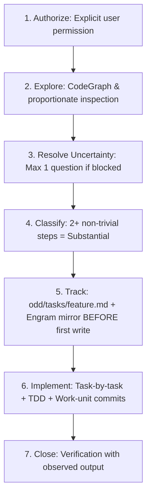

# 🌿 odd-workflow — Organic Driven Development (ODD)

The universal, disciplined protocol for software delivery across AI agents. Replaces speculative planning and chaos with verifiable, atomic iterations.

---

## 🚫 ABSOLUTE BANS (Non-Negotiable)

1. **NO WRITING BEFORE TRACKING**: For substantial work (2+ files or steps), NEVER touch a source code file before creating `odd/tasks/<feature>.md` and its Engram mirror under `odd/<feature>/tasks`.
2. **NO GUESSWORK ON PRODUCT DECISIONS**: Never guess unstated business logic. Ask exactly ONE focused question and STOP until answered.
3. **NO VERBAL CLAIMS WITHOUT OBSERVED EVIDENCE**: Never output "it works" or mark a task complete without executing and observing the verification command output in the current session.
4. **NO MONOLITHIC MULTI-TASK COMMITS**: Every task closes with its own atomic work-unit commit on the feature branch with tests and docs included.
5. **NO UI MUTATION WITHOUT DESIGN GATE (D1b)**: For changes touching frontend or visual surfaces, NEVER emit component markup or styling without executing the Design Read and establishing the Creative DNA Archetype from `design-driven` D1b.


---

## 🧭 The 7-Step ODD Protocol



1. **Authorize**: Verify explicit authorization for code mutation. Audits and explorations remain read-only.
2. **Explore**: Read existing codebase proportionately before designing or proposing code.
3. **Resolve Uncertainty**: Ask at most ONE focused question if blocked by an unresolved product decision.
4. **Classify**: Mark as *Substantial* if the change touches 2+ non-trivial files or has progress worth recovering.
5. **Track before first write**: Create `odd/tasks/<feature>.md` and its Engram mirror `odd/<feature>/tasks`. Tell user in exactly one line: `"Created odd/tasks/<feature>.md with N tasks."`
6. **Implement task-by-task**: Route each task (inline or delegated writer), apply TDD (RED -> GREEN), close with a work-unit commit on the feature branch, and record the commit hash in the feature doc.
7. **Close & Verify**: Run all gates, report observed evidence, detail passed/skipped checks, and define next step.

---

## ⚖️ Before & After: Ad-Hoc Execution vs ODD Protocol

| ❌ Ad-Hoc Chaos | ✅ ODD Disciplined Execution |
|---|---|
| Modifies 4 files immediately without tracking or task document | Creates `odd/tasks/<feature>.md` and Engram mirror *before* first source edit |
| Piles up 500 lines of uncommitted diff and pushes a single mega-commit | Commits atomically after each task (`feat(...)`, `fix(...)`) with tests included |
| Claims "tests pass" without running them | Runs test runner and prints exact observed command output as evidence |
| Assumes business rules and builds wrong feature | Asks 1 focused clarification question on ambiguity, stops, and waits |

---

## 📋 Feature Document Template (`odd/tasks/<feature>.md`)

```markdown
# Feature: <Name>

- **Status**: IN PROGRESS
- **Branch**: feat/<feature-name>
- **Engram Topic**: odd/<feature-name>/tasks

## Objective
Concrete, testable outcome.

## Tasks
- [ ] T1: Task title and deliverable outcome
- [ ] T2: Task title and deliverable outcome

## Progress & Verification
- Record observed command runs and commit hashes per task.
```
