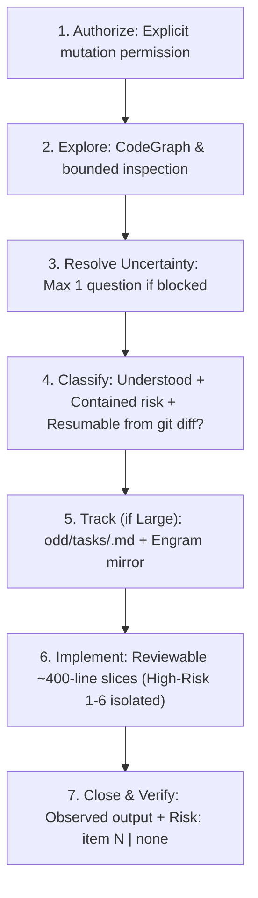

# 🌿 odd-workflow — Organic Driven Development (Gentle-AI 4.2.0)

The universal, disciplined protocol for software delivery across AI agents. Replaces speculative planning and ad-hoc chaos with verifiable, reviewable work-unit slices.

---

## 🚫 ABSOLUTE BANS (Non-Negotiable)

1. **NO WRITING BEFORE TRACKING ON LARGE WORK**: When the resume test fails (large task), NEVER touch a source file before creating `odd/tasks/<feature>.md` and its Engram mirror `odd/<feature>/tasks`.
2. **NO CLASSIFICATION BY FILE OR STEP COUNT**: Never classify task size by counting files, steps, commands, tests, or a todo list. Use only the 3 Task Size criteria.
3. **NO GUESSWORK ON PRODUCT DECISIONS**: Never guess unstated business logic. Ask at most ONE focused question and STOP until answered.
4. **NO VERBAL CLAIMS WITHOUT OBSERVED EVIDENCE & RISK LINE**: Never claim completion without running verification commands, observing output, and closing with `Risk: item N (reason)` or `Risk: none`.
5. **NO UI MUTATION WITHOUT DESIGN GATE (D1b)**: For frontend or visual changes, establish the Creative DNA Archetype (`design-driven` D1b) before emitting UI code.

---

## 🧭 The 7-Step ODD Protocol (Gentle-AI 4.2.0)



1. **Authorize**: Establish whether the request explicitly authorizes code mutation. Investigations, reviews, audits, and planning remain strictly read-only.
2. **Explore**: Inspect existing code proportionately (CodeGraph first for structural questions) before proposing or writing.
3. **Resolve Uncertainty**: Recommend optional research only for a named uncertainty; ask at most ONE focused question for an unresolved product decision, then stop and wait.
4. **Classify (Task Size & Resume Test)**: A task is **Small** when all three hold:
   - **Understood**: Outcome and edit locations are proven within `<= 1` parallel batch (`<= 3` calls, `~10k` tokens) with no open product decision.
   - **Contained risk**: Touches none of the 6 High-Risk items below.
   - **Resumable from `git diff` alone** (*Resume Test*): If the session stopped now, someone could finish from the original request and `git diff` alone.
   A task is **Large** only when the Resume Test fails (multi-session, external wait, separate deliverables, or requirements too long to survive compaction). Small work stays inline without durable task files.
5. **Track before first write**: For large authorized work, create `odd/tasks/<feature>.md` and its Engram mirror `odd/<feature>/tasks` automatically before the first source edit. Tell the user in one line which document was created and how many tasks it holds.
6. **Implement task-by-task**: Work inline by default. Commit work units in reviewable slices of `~400` authored changed lines on the feature branch (with code + tests + docs together). Any unit whose `Risk:` line names a High-Risk item (`1-6`) gets its own isolated commit (closing any pending `under_budget` slice first; if native RDD is unavailable due to an absent `gentle-ai` binary or SMB/UNC path, report `receipt-driven development: unavailable` and follow ordinary repository policy). Record the commit hash holding each task in `odd/tasks/<feature>.md`.
7. **Close & Verify**: Report the verified outcome, every failed/skipped/pending check, and the next step. Close every code change with `Risk: item N (reason)` or `Risk: none`.

---

## ⚠️ The 6 High-Risk Items & Mandatory `Risk:` Line

High risk means a mistake is hard to detect, hard to undo, or reaches beyond the change:
1. **Data or irreversible effects**: Migrations, changing/deleting existing stored data, persisted format changes (not saving new records).
2. **Security**: Auth, permissions, credentials, secrets, guards, sandbox.
3. **Contracts others consume**: Changing/removing public API, CLI flags, config formats, published exports, mirrored prompts/contracts, or unrequested changes in shared options, parsers, or helpers.
4. **Concurrency**: Locks, races, async ordering.
5. **Delivery or environment**: Installers, release, CI, deploy, dependencies.
6. **Untested surface**: No test would catch a regression in what changes.

**Mandatory closure**: Every code change (small or large, inline or delegated) MUST close with `Risk: item N (reason)` or `Risk: none`. Before writing `Risk: none`, check whether the diff touches code used by existing behavior the request did not mention (shared options, parsers, helpers); if so, declare `Risk: item 3 (...)`.

### Delegation Triggers

You orchestrate and work inline by default, following your logbook. **A Delegation Trigger holds only when its condition truly holds; none holds by default, and when in doubt work inline.**

- **Ask trigger**: Open product or design decision -> ask 1 focused user question; stop and wait.
- **Mapping trigger**: Understanding exceeds 1 inline batch (`> 3` calls or `> ~10k` tokens) or needs `> ~5` sequential lookups -> delegate 1 read-only explorer returning `<= 2k` tokens with `path:line` evidence; at most 1 parent spot-check.
- **Writer trigger**: Delegate bounded writers ONLY for:
  - *(a) Parallelism*: `2+` independent behavioral units with disjoint edit surfaces, each `~100+` authored changed lines / several minutes (clearly heavier than starting a subagent), launched together. Never split code, tests, and docs of the same behavior across writers.
  - *(b) Context backstop*: At `~150k` parent-context tokens, pause and delegate the next bounded unit.
  Never delegate a writer for task size, file count, or model price ratio alone.
- **Invariants & Helper Reuse**: When modifying shared state, parsers, or manifests, reuse existing codebase helpers and preserve ordering, uniqueness, validation, and normalization invariants.
- **Verification trigger**: Delegate an independent read-only verifier ONLY when a High-Risk item (`1-6`) applies, passing `--escalate-item <1-6> --escalate-reason "<reason>"`. Never run an independent verifier merely because a writer used a smaller/cheaper model or lower effort tier.

---

## 🧪 Differential Check & Scratch State Discipline

- **Differential Check (`mktemp -d`)**: When a change touches shared CLI commands, parsers, routers, or helpers (item 3 candidate), verify that unrequested behavior is unchanged by comparing output against a clean baseline worktree created in a temporary directory (`mktemp -d` / `os.tmpdir()`) before and after the change.
- **Scratch State Discipline**: Never leave temporary reproduction scripts or scratch directories inside the repository tree. Subagents must report any scratch paths created outside the workspace so the parent orchestrator removes them before task closure.

---

## 📋 Canonical Feature Document Template (`odd/tasks/<feature>.md`)

Keep this exact section order (2-3 line header first, `## Log` last) so subagents read until `## Log` by reference (`Spec: odd/tasks/<feature>.md, T1, S1`):

```markdown
Objective: <Concrete, testable outcome>
Branch: feat/<feature-name> | Delivery: reviewable work-unit slices on feature branch
Test runner: <exact test & validation command>

## Specs

- **S1**: Quote user's exact strings, error messages, commands, and examples verbatim. Canonical refs: `PRD.md#FR-01`, `APP_FLOW.md`, `TRD.md`, `DESIGN_SYSTEM.md`.
- **S2**: Next requirement with authorized scope and acceptance checks.

## Tasks

- [ ] **T1** (`S1`, route: inline, commit: pending) — Deliverable behavior + tests + docs.
- [ ] **T2** (`S2`, route: delegated writer — parallel unit A, commit: pending) — Deliverable behavior + tests + docs.

## Log

- **L1 (YYYY-MM-DD)**: <User's original request verbatim>
```

---

## 🧭 Floor, Not Ceiling (`[Beyond-Baseline]`)

ODD provides the engineering discipline floor. While preserving non-negotiable invariants (security, `pnpm-only`, observed test evidence, and mandatory `Risk:` closure), agents may apply higher-leverage verification such as property-based testing or automated differential harnesses when annotated with `[Beyond-Baseline: <technical reason>]`.
