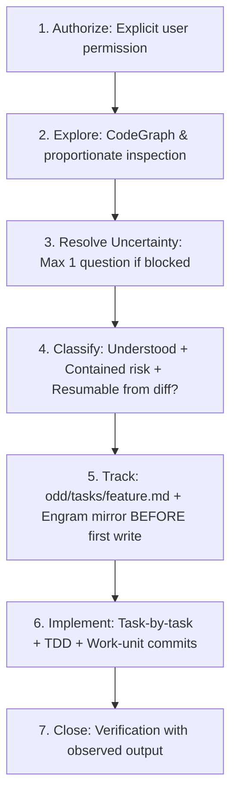

# 🌿 odd-workflow — Organic Driven Development (ODD)

The universal, disciplined protocol for software delivery across AI agents. Replaces speculative planning and chaos with verifiable, atomic iterations.

---

## 🚫 ABSOLUTE BANS (Non-Negotiable)

1. **NO WRITING BEFORE TRACKING**: For substantial/large work (where the resume test fails or risk is not contained), NEVER touch a source code file before creating `odd/tasks/<feature>.md` and its Engram mirror under `odd/<feature>/tasks`.
2. **NO GUESSWORK ON PRODUCT DECISIONS**: Never guess unstated business logic. Ask exactly ONE focused question and STOP until answered.
3. **NO VERBAL CLAIMS WITHOUT OBSERVED EVIDENCE**: Never output "it works" or mark a task complete without executing and observing the verification command output in the current session.
4. **NO MONOLITHIC MULTI-TASK COMMITS**: Every task closes with its own atomic work-unit commit on the feature branch with tests and docs included.
5. **NO UI MUTATION WITHOUT DESIGN GATE (D1b)**: For changes touching frontend or visual surfaces, NEVER emit component markup or styling without establishing the Creative DNA Archetype from `design-driven` D1b (via 5-block interview / auto-inference on greenfield, or 1-line Fast-Path Design Read on incremental maintenance).


---

## 🧭 The 7-Step ODD Protocol



1. **Authorize**: Verify explicit authorization for code mutation. Audits and explorations remain read-only.
2. **Explore**: Read existing codebase proportionately before designing or proposing code.
3. **Resolve Uncertainty**: Ask at most ONE focused question if blocked by an unresolved product decision.
4. **Classify**: Size by ODD's 3 criteria (**Understood**, **Contained risk**, **Resumable from `git diff` alone**). Never classify by counting files, commands, or tests; mark as *Substantial/Large* when the resume test fails or multiple deliverables/sessions are involved.
5. **Track before first write**: Create `odd/tasks/<feature>.md` and its Engram mirror `odd/<feature>/tasks`. Tell user in exactly one line: `"Created odd/tasks/<feature>.md with N tasks."`
6. **Implement task-by-task**: Route each task (inline or delegated writer), apply TDD (RED -> GREEN), close with a work-unit commit on the feature branch, and record the commit hash in the feature doc.
7. **Close & Verify**: Run all gates, report observed evidence, detail passed/skipped checks, and define next step.

---

## ⚖️ Before & After: Ad-Hoc Execution vs ODD Protocol

| ❌ Ad-Hoc Chaos | ✅ ODD Disciplined Execution |
|---|---|
| Modifies 4 files immediately without tracking or task document | Creates `odd/tasks/<feature>.md` and Engram mirror *before* first source edit |
| Piles up 500 lines of uncommitted diff and pushes a single mega-commit | Commits atomically after each task (`feat(...)`, `fix(...)`) with tests included |
| Claims "tests pass" without running them | Runs test runner and prints exact observed command output as evidence |
| Assumes business rules and builds wrong feature | Asks 1 focused clarification question on ambiguity, stops, and waits |

---

## 📋 Feature Document Template (`odd/tasks/<feature>.md`)

```markdown
# Feature: <Name>

- **Status**: IN PROGRESS
- **Branch**: feat/<feature-name>
- **Engram Topic**: odd/<feature-name>/tasks
- **Canonical References**: PRD.md (FR-01..FR-n) | APP_FLOW.md (Routes) | TRD.md (Traceability Matrix) | DESIGN_SYSTEM.md (Tokens/Chassis)

## Objective
Concrete, testable outcome.

## Specs
- S1: Target FR-01 and FR-02 from PRD.md / APP_FLOW.md screen /auth/login.
- S2: Technical contract per TRD.md §3 and design tokens per DESIGN_SYSTEM.md.

## Tasks
- [ ] T1 (S1) [inline]: Task title, deliverable outcome, commit hash
- [ ] T2 (S2) [inline]: Task title, deliverable outcome, commit hash

## Progress & Verification
- Record observed command runs and commit hashes per task.

## Log
- L1: Initial requirement verbatim.
```

### 🔗 Canonical Document Pipeline Integration (`PRD.md`, `APP_FLOW.md`, `TRD.md`, `DESIGN_SYSTEM.md`)

When working on projects with canonical architectural artifacts, `odd/tasks/<feature-name>.md` references them directly instead of duplicating specifications:
- **`PRD.md`** (`idea-to-prd-express`): Link specs directly to Functional Requirements (`FR-01`, `FR-02`...) and Acceptance Criteria.
- **`APP_FLOW.md`** (`app-flow-spec`): Link specs to verified routes, role guards, and Mermaid state machine transitions.
- **`TRD.md`** (`architecture-designer`): Map directly to the Traceability Matrix (`FR-# -> Route -> Component -> Task T#`), API endpoints, and schema models.
- **`DESIGN_SYSTEM.md`** (`design-driven`, `design-system-tokens`): Reference semantic CSS tokens (`--surface-*`, `--text-*`, `--accent-*`), chassis archetype, and component state invariants.
- **Zero Duplication**: Reference identifiers (`Spec: PRD.md#FR-03`, `Route: /checkout/pay`, `Token: --accent-primary`); do not re-transcribe entire documents.

