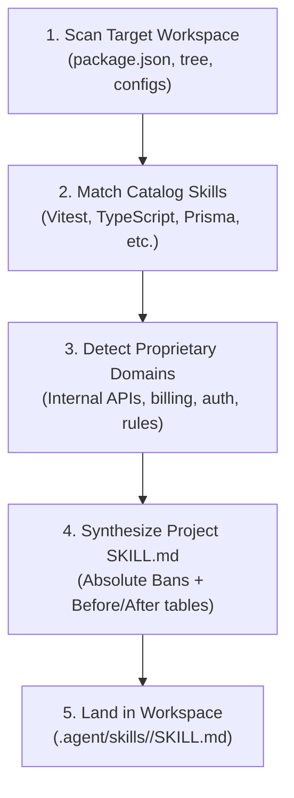

# ⚗️ Project-Scoped Skill Distiller

The **Skill Distiller** bridges generic catalog skills and repository-specific engineering reality. It inspects a target project's tech stack, directory structure, and domain boundaries to:
1. **Discover & Link**: Identify existing catalog skills that match the project's dependencies and tooling.
2. **Synthesize & Localize**: Distill custom domain invariants, internal architectural patterns, and negative constraints into a project-local skill (`<target>/.agent/skills/<domain>/SKILL.md`).

---

## 🚫 Absolute Bans

| Anti-Pattern | Why It Is Banned | Enforced Alternative |
|---|---|---|
| **Contaminating Global Catalog** | Project-specific rules (internal DTOs, custom RPC) must never leak into the universal 229-skill catalog. | Write distilled skills strictly to `<target>/.agent/skills/<domain>/`. |
| **Vague Generic Guidance** | An LLM falls back to sloppy defaults if a project skill only gives polite recommendations. | Include mandatory Negative Constraints (Absolute Bans) and Before/After tables in every generated skill. |
| **Unapproved Package Runners** | Inconsistent command execution breaks monorepos and CI pipelines. | Bind generated skills to monorepo approved package managers (pnpm only). |
| **Undocumented Invariants** | Unwritten domain rules force repeated developer corrections. | Extract domain entities, validation schemas, and error hierarchies into explicit patterns. |

---

## 🧭 Distillation Workflow



### Step 1: Scan Target Workspace
Run the distiller CLI against the target repository:
```bash
pnpm distill --target /path/to/project --domain order-fulfillment
```

### Step 2: Inspection Criteria
The distiller scans:
- **Manifests**: `package.json`, `pnpm-workspace.yaml`, `tsconfig.json`.
- **Domain Boundaries**: `src/domain/`, `src/modules/`, `src/services/`, database schemas.
- **Architectural Patterns**: Repository pattern, CQRS, event handlers, RPC clients.

### Step 3: Generated Project Skill Structure
The synthesized skill is saved under `<target>/.agent/skills/<domain>/SKILL.md` following the `agentskills.io` standard:
- **YAML Frontmatter**: `name`, `description` with explicit exclusion clause (`Do NOT use for...`), and `metadata.scope: [project-local]`.
- **Absolute Bans Table**: Explicit negative constraints forbidding common mistakes in that specific domain.
- **Before & After Pattern Table**: Clear architectural examples demonstrating correct vs incorrect implementations.
- **Verification Commands**: Deterministic test and lint commands to verify compliance.

---

## 📊 Before & After Distillation

| Dimension | Before (Ad-hoc Prompting) | After (Distilled Project Skill) |
|---|---|---|
| **Domain Invariants** | Agent invents ad-hoc models and throws generic errors. | Agent strictly follows project DTOs and typed domain error classes. |
| **Persistence Boundary** | Raw SQL or unparameterized queries in HTTP handlers. | Enforces repository abstraction and transactional units. |
| **Testing Standards** | Generates unmocked tests or tautological assertions. | Generates pure AAA tests with mock cleanup and coverage checks. |
| **Agent Portability** | Every new session requires re-explaining the domain. | Agent automatically loads `.agent/skills/<domain>/SKILL.md` via progressive disclosure. |
