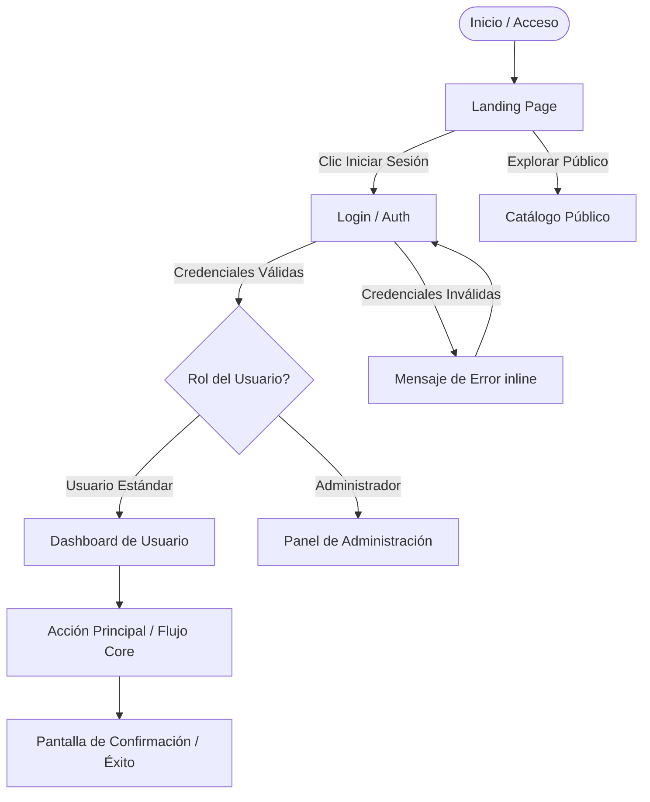
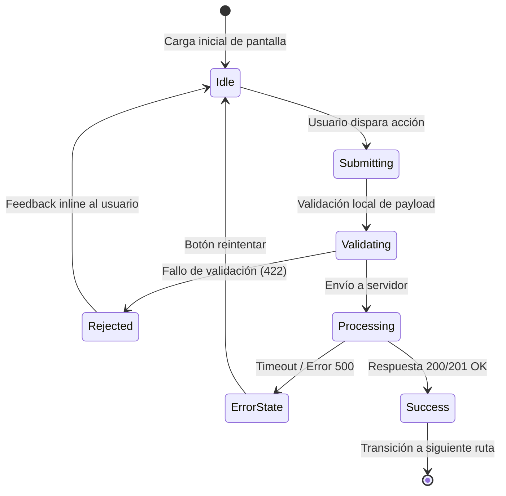

# Application Flow Specification (APP_FLOW.md)

> **Artefacto Canónico**: `APP_FLOW.md`  
> **Basado en**: `PRD.md`  
> **Estado**: Aprobado  
> **Fecha**: YYYY-MM-DD  

---

## 1. Mapa de Rutas y Permisos por Rol

| Ruta / Pantalla | Nombre Componente | Roles Autorizados | Guard / Middleware | Descripción |
|---|---|---|---|---|
| `/` | `LandingView` | `PUBLIC` | Ninguno | Bienvenida, propuesta de valor y acceso principal. |
| `/login` | `LoginView` | `ANONYMOUS_ONLY` | `GuestOnlyGuard` | Autenticación de usuarios existentes. |
| `/dashboard` | `DashboardView` | `AUTHENTICATED` | `AuthGuard` | Resumen de actividad principal y métricas clave. |
| `/admin/*` | `AdminModule` | `ROLE_ADMIN` | `RoleGuard(['ADMIN'])` | Configuración del sistema y gestión operativa. |

---

## 2. Diagramas de Flujo y Navegación (Mermaid)

### 2.1 Flujo Principal de Navegación

### 2.2 Máquina de Estados del Flujo Crítico

---

## 3. Matriz de Estados por Pantalla

Toda pantalla debe considerar explícitamente sus 5 estados visuales y de interacción:

| Pantalla | Empty State | Loading State | Populated State | Error State | Offline / Edge Case |
|---|---|---|---|---|---|
| `DashboardView` | "Sin actividad aún. Crea tu primer elemento." + CTA | Skeleton loaders alineados a grid | Grid con métricas reales y gráficos | Banner de alerta con reintento manual | Banner de reconexión y cache local |
| `ItemListView` | Ilustración neutra + acción rápida | Skeleton rows con shimmer | Lista paginada con scroll virtual | Mensaje de fallo de red con retry | Lectura de IndexedDB / stale-while-revalidate |
| `CheckoutView` | Carrito vacío con enlace a catálogo | Botón de pago con spinner y disabled | Resumen de orden y desglose claro | Error específico del emisor o pasarela | Alerta de bloqueo de idempotencia |

---

## 4. Tabla de Transiciones de Estado

| Pantalla Origen | Evento / Disparador | Validación / Precondición | Destino Exitoso | Destino de Error |
|---|---|---|---|---|
| `LoginView` | Submit de formulario | Email válido y password no vacío | `/dashboard` (setea sesión) | `LoginView` (error inline visible) |
| `ItemCreateView` | Clic "Guardar" | Campos obligatorios Zod validados | `/items/:id` con toast de éxito | `ItemCreateView` con campos resaltados |
| `DashboardView` | Clic "Cerrar Sesión" | Token presente | `/login` (limpia sesión) | `/login` (forzado tras timeout) |
| `CheckoutView` | Clic "Pagar" | Tarjeta válida + idempotency key | `/order/:id/confirmation` | `/checkout` con causa exacta de rechazo |
