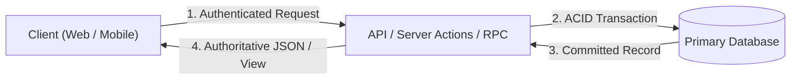
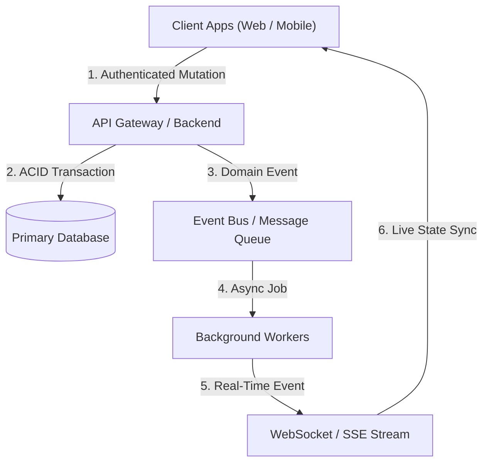

# 🌐 Fullstack Application Workflow Orchestrator

Use this skill to design, integrate, and verify end-to-end business workflows across a fullstack architecture. It establishes standard interaction patterns between client interfaces (web, mobile), API layers, transactional databases, background job queues, and real-time streams.

---

## 🏛️ Architectural Workflow Patterns

### Pattern A: Direct Synchronous & Server-Driven (Default Baseline)

Ideal for standard CRUD, SaaS platforms, administration panels, forms, and workflows where immediate request/response fulfills user needs without persistent websocket connections:

1. **Validation & Auth**: Validate inputs (Zod/TypeScript) and verify session/permissions.
2. **Transactional Mutation**: Execute atomic mutations in a single database transaction.
3. **Immediate Resolution**: Return authoritative response with fresh state directly to client.

---

### Pattern B: Reactive Real-Time & Event-Driven (Streaming Workflows)

Apply when multi-user collaboration, live status tracking, instant notifications, or high-throughput async processing is an explicit product requirement:

1. **Transactional Ingestion**: Client triggers action; backend verifies invariants and commits core transaction.
2. **Asynchronous Dispatch**: On transaction commit, emit domain events to an in-memory queue, Redis Pub/Sub, or message broker.
3. **Worker Processing**: Background workers handle external integrations (emails, push notifications, third-party APIs) without blocking client threads.
4. **Real-Time Broadcast**: Push status transitions over scoped WebSocket rooms or Server-Sent Events (SSE) to active subscribers.
5. **Optimistic Reconciliation**: Client UI reconciles optimistic local state against server broadcast.

---

## 🧭 Pattern Selection Criteria

| Product Requirement | Recommended Pattern | Reference Skills |
|---|---|---|
| Standard form submissions, CRUD, settings, dashboards | **Pattern A (Direct)** | `04-backend/postgresql`, `04-backend/prisma-orm` |
| Collaborative editing, live driver/courier GPS tracking | **Pattern B (Real-time)** | `04-backend/socketio`, `05-frontend/maps-gps` |
| Asynchronous long-running jobs (video processing, exports) | **Hybrid (A + Worker Queue)** | `04-backend/background-jobs-queues` |
| Mobile alerts on state transitions | **Hybrid (A or B + Push)** | `05-frontend/push-notifications` |

---

## 📚 Domain References

- **E-Commerce & Delivery Reference Case**: [`references/e-commerce-delivery-example.md`](references/e-commerce-delivery-example.md) demonstrates a full implementation coordinating both patterns across multi-role actors.
- **Traceability in ODD**: Map chosen workflow patterns directly into `TRD.md` and feature tasks in `odd/tasks/<feature>.md`.
