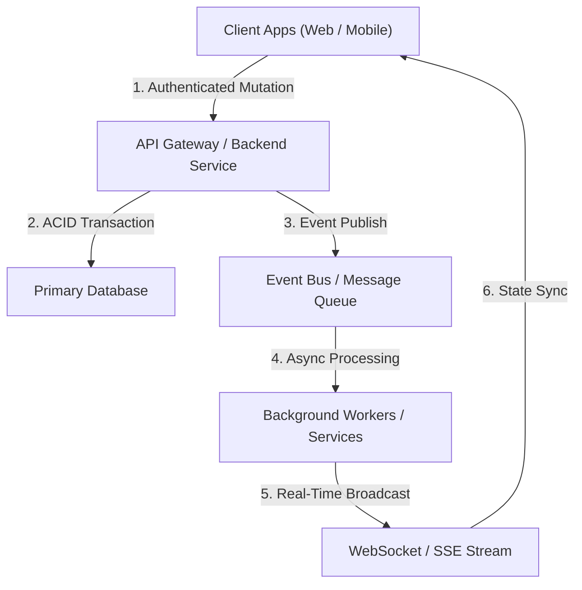

# 🌐 Fullstack Application Workflow Orchestrator

Use this skill to guide the design, integration, and verification of end-to-end business workflows across a fullstack architecture. It coordinates client interfaces (mobile, web), API gateways, relational databases, event queues, and real-time streaming layers into a coherent lifecycle.

---

## 🏛️ Core Workflow Lifecycles

### 1. Synchronous Request & Transactional Boundary
1. **Client Ingestion**: Client triggers an authenticated action with schema-validated input (e.g. Zod, TypeScript types).
2. **Pre-flight Policy & Auth**: Middleware verifies session identity, RBAC permissions, and idempotency keys.
3. **Transactional Execution**:
   - Wrap state modifications in an atomic database transaction.
   - Enforce domain invariants before persistence.
   - Commit transaction or roll back on error with clear domain diagnostics.
4. **Immediate Response**: Return an authoritative acknowledgement with the new entity status (e.g., `PENDING` or `PROCESSING`).

### 2. Asynchronous Event Processing & Worker Queues
1. **Event Dispatch**: On transaction commit, emit domain events to an in-memory queue, Redis Pub/Sub, or message broker.
2. **Worker Processing**: Background workers process heavy tasks (email notifications, data indexing, third-party webhook relays) without blocking the primary request thread.
3. **Failure Handling**: Configure dead-letter queues (DLQ), exponential backoff retries, and circuit breakers for external integrations.

### 3. Real-Time Streaming & State Synchronization
1. **Channel Subscription**: Clients join scoped real-time channels or rooms (e.g. `entity:<id>`, `user:<id>`) after verifying authentication tokens.
2. **State Updates**: Services emit state transitions over WebSocket or Server-Sent Events (SSE) connections.
3. **Optimistic Reconciliation**: Client UI applies optimistic updates while reconciling against authoritative server payloads.
4. **Completion & Audit**: Log finalized status, metrics, and telemetry for observability.

---

## 📚 Domain References

- For a complete e-commerce and on-demand delivery domain implementation example, see [`references/e-commerce-delivery-example.md`](references/e-commerce-delivery-example.md).
