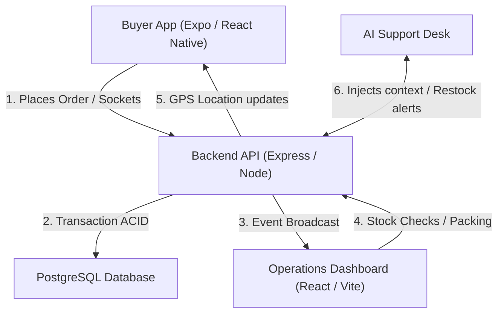

# E-Commerce & Delivery Domain Architecture Example

This reference documents the e-commerce and on-demand delivery architecture workflow pattern for fullstack applications.

---

## E-Commerce Pipelines

### Pipeline A: Order Placement & Inventory Check
1. **Client Request**: The buyer selects items in the mobile catalog.
2. **Checkout Validation**: The mobile app triggers client validation and transmits payload via secure authenticated endpoints.
3. **Transaction Execution**: The backend executes an ACID transaction verifying inventory levels:
   - If stock is sufficient, creates the `Order` record, decrements stock, commits transaction, and sets status to `PENDING`.
   - If stock is insufficient, rolls back transaction and returns domain error.
4. **WebSocket Event**: The backend emits an `order:created` event via Socket.io to the operations dashboard room.

### Pipeline B: Fulfillment & Out-of-Stock Resolution
1. **Fulfillment Queue**: Warehouse or packing staff view pending orders in the operations dashboard.
2. **Item Inspection**: If an item is unavailable or damaged, staff triggers a stock discrepancy alert.
3. **AI Resolution Assistance**: The backend triggers an automated assistant:
   - Analyzes user preferences and available similar catalog inventory.
   - Generates a substitution proposal pushed to the buyer in real time.
4. **Customer Approval**: When the buyer confirms, the order is updated to `PACKED`.

### Pipeline C: Dispatch & Live GPS Tracking
1. **Courier Assignment**: Staff assigns the package to an active driver; status changes to `IN_TRANSIT`.
2. **Route Optimization**: Backend calculates waypoints and displays navigation on the driver's interface.
3. **Live GPS Stream**: The driver's device streams GPS coordinates via WebSockets every 5 seconds.
4. **Customer Live Map**: The buyer client subscribes to the socket room and renders real-time location.
5. **Completion**: Courier marks order as `DELIVERED`; webhook triggers transaction finalization.
