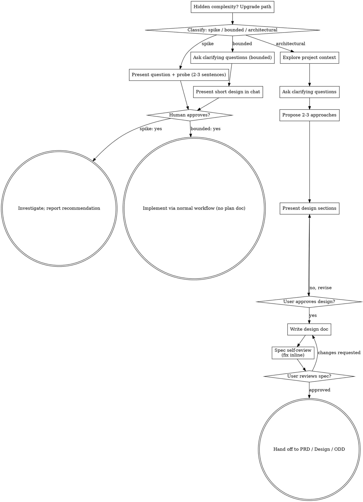

# Brainstorming — Ideation Frameworks, Checklists & Process Flow

Full process diagrams, architectural facilitation guidance, spec self-review rules, and Visual Companion usage criteria referenced by [`SKILL.md`](../SKILL.md).

## 1. Detailed Checklists by Path

### Spike
1. **Explore project context** — enough to frame the probe.
2. **Present question + probe plan** — 2–3 sentences.
3. **Get approval** — a nod is enough.
4. **Investigate** — as cheaply as correctness allows.
5. **Report findings** — return a recommendation; label anything built as throwaway.

### Bounded
1. **Explore project context** — check files, docs, recent commits.
2. **Ask clarifying questions** — one at a time, only the ones that matter.
3. **Present short design in chat** — approach, files touched, testing.
4. **Get approval** — STOP and wait for an explicit yes before writing code.
5. **Implement** — proceed via normal ODD development workflow (TDD applies); no plan document.

### Architectural
1. **Explore project context** — check files, docs, recent commits.
2. **Offer the visual companion just-in-time** — NOT upfront; offer it as its own message only when a genuinely visual mockup/diagram/layout comparison arises (see [`../visual-companion.md`](../visual-companion.md)).
3. **Ask clarifying questions** — one at a time; understand purpose, constraints, and success criteria.
4. **Propose 2–3 approaches** — with trade-offs and a clear lead recommendation.
5. **Present design** — in sections scaled to complexity; get approval after each section.
6. **Write design doc** — save to `docs/superpowers/specs/YYYY-MM-DD-<topic>-design.md` (or user-preferred spec path) and commit.
7. **Spec self-review** — inline scan for placeholders (`TBD`/`TODO`), contradictions, scope focus, and ambiguity.
8. **User reviews written spec** — wait for explicit approval before downstream handoff.
9. **Transition to downstream pipeline** — invoke `idea-to-prd-express` (`PRD.md`), `design-driven` (`DESIGN_SYSTEM.md`), or `odd-workflow` (`odd/tasks/<feature>.md`).

## 2. Process Flow Diagram

Terminal states are path-bound: Architectural hands off to `idea-to-prd-express`, `design-driven`, or `odd-workflow`; Bounded proceeds inline via ODD with no separate plan document; Spike terminates in a reported recommendation.

## 3. Facilitation Playbook

- **Scope Decomposition**: If a request names multiple independent subsystems (chat, billing, storage, analytics), decompose sub-projects first and brainstorm them sequentially.
- **One Question Per Message**: Prefer multiple choice where clear; split multi-part topics across turns.
- **Exploring Approaches**: Lead with 2–3 distinct architectural approaches, trade-offs, your recommendation, and ruthless YAGNI trimming.
- **Design for Isolation & Clarity**: Keep units single-purpose with explicit public contracts so callers reason without reading internals.
- **Working in Existing Codebases**: Inspect existing patterns first; include targeted local improvements when directly relevant to the goal without unrelated refactoring.

## 4. After the Design & Visual Companion Criteria

- **Spec Self-Review & User Gate**: Remove all `TBD`/`TODO` placeholders, resolve contradictions, confirm single-cycle focus, and ask the user:
  `"Spec written and committed to <path>. Please review it and let me know if you want to make any changes before we start writing out the implementation plan."`
- **Visual Companion Just-in-Time Rule**: Wait until a visual layout/diagram/wireframe choice would genuinely be clearer shown than told, offer it as its own message (no appended question), start with `--open` only on acceptance, and decide **per question** between browser (wireframes, architecture diagrams, side-by-side layouts) vs terminal (requirements, A/B/C/D tradeoffs, scope). Full browser guide: [`../visual-companion.md`](../visual-companion.md).
