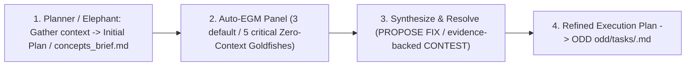

# 🐘🐠 EGM Spec Review — Mandatory Auto-EGM Gate for Large Plans

Coordinates deep-context specification authoring (**Elephant**) with zero-context adversarial subagent critics (**Goldfishes**) from the external EGM plugin installed at `~/.gemini/config/plugins/egm/` before committing to code under `skillsGV` ODD (`Gentle-AI 5.0.0`, Contract `1.6.0`).

---

## ⚡ Mandatory Auto-EGM Gate & Efficiency Tiers

When planning **Large tasks** (failing the ODD Resume Test), **major system upgrades**, or **heavy-logic / high-compute architectures**, passing the planner's initial draft through EGM is **mandatory** — while scaling panel size to preserve speed and token budget:

| Plan Tier | Activation Condition | Goldfish Panel | Skip / Fallback Rule |
|---|---|---|---|
| **Small / Contained** | Passes ODD Resume Test (`Understood + Contained + Resumable`) | **0 agents (SKIP)** | Never burn Goldfish tokens on small fixes or single-unit changes |
| **Large / Heavy-Logic** *(Default Mandatory)* | Multi-unit plan, heavy state/algorithmic logic, or major upgrade | **3-Goldfish Fast Panel** (`egm-zoom-out`, `egm-codebase-details`, `egm-implementation-readiness`) | Run in 1 parallel `invoke_subagent` batch against the planner's draft |
| **Critical / High-Risk** | Security/auth boundaries, breaking migrations, or cross-repo contracts | **5-Goldfish Full Panel** (`+ egm-design`, `+ egm-comprehension`) | Add `egm-inventive-catalyst` / `egm-structural` only if design has unresolved contradictions |

> **Portable Runtime Fallback**: If `~/.gemini/config/plugins/egm/` or `egm-*` subagents are unavailable in the active runtime (e.g., Claude Code/OpenCode/Codex without the plugin), spawn `2–3` fresh zero-context read-only subagents with zero prior conversation history carrying those exact 3 lenses before finalizing the plan.

---

## 🧭 Role Separation & Workflow

1. **Planner / Elephant (Full Context, Zero Production Code)**: Load `AGENTS.md`, `SKILLS.md`, `Engram` memory (`mem_search`), Graphify module boundaries, and project specs (`PRD.md` / `TRD.md`). Emit the initial plan / `design_draft.md` without mutating implementation files.
2. **Goldfish Panel (Zero Prior Conversation Bias via `invoke_subagent`)**: Dispatch independent reviewers in parallel across the selected tier (`egm-zoom-out` YAGNI/simplicity, `egm-codebase-details` ground-truth reuse, `egm-implementation-readiness` ambiguity/runnability; plus `egm-design` scalability/economics/risks and `egm-comprehension` clarity for critical scopes).
3. **Adversarial Synthesis & Resolution (`CONTEST` Allowed)**: Deduplicate real blockers (`consolidated_review_report.md` or inline synthesis for medium-large plans). Under `Floor, Not Ceiling`, accept valid blockers (`PROPOSE FIX`) and reject invalid critiques with repo evidence (`CONTEST`) before marking the refined plan ready.
4. **ODD Execution Handoff**: Transition the refined plan into `odd-workflow` (`odd/tasks/<feature>.md` + Engram mirror + 5-line Pre-Flight Micro-Blueprints per work unit).

---

## 🔗 Ecosystem Integration

- [`../brainstorming/SKILL.md`](../brainstorming/SKILL.md) — Early Spike / Bounded / Architectural exploration
- [`../idea-to-prd-express/SKILL.md`](../idea-to-prd-express/SKILL.md) — Upstream functional `PRD.md` synthesis
- [`../../02-dev-roles/decision-gate/SKILL.md`](../../02-dev-roles/decision-gate/SKILL.md) — Fast human decision resolution on contested trade-offs
- [`../../00-meta-skills/odd-workflow/SKILL.md`](../../00-meta-skills/odd-workflow/SKILL.md) — Downstream tracked execution (`odd/tasks/<feature>.md`)
