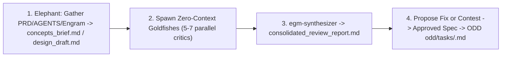

# 🐘🐠 EGM Spec Review — Elephant-Goldfish Adversarial Design Critique

Coordinates deep-context specification authoring (**Elephant**) with zero-context adversarial subagent critics (**Goldfishes**) from the external EGM plugin installed at `~/.gemini/config/plugins/egm/` before committing to code under `skillsGV` ODD (`Gentle-AI 4.4.0`).

---

## 🧭 Role Separation & Workflow

1. **Elephant (Full Context, Zero Production Code)**: Load `AGENTS.md`, `SKILLS.md`, `Engram` memory (`mem_search`), Graphify module boundaries, and project specs (`PRD.md` / `TRD.md`). Author `concepts_brief.md` or `docs/designs/<feature>.md` without mutating implementation files.
2. **Goldfish Panel (Zero Prior Conversation Bias via `invoke_subagent`)**: Dispatch independent reviewers across core lenses (`egm-zoom-out` YAGNI/simplicity, `egm-codebase-details` ground-truth reuse, `egm-design` scalability/economics/risks, `egm-implementation-readiness` ambiguity/runnability, `egm-comprehension` glossary/clarity, plus `egm-structural`, `egm-style`, and `egm-inventive-catalyst` TRIZ).
3. **Adversarial Synthesis & Resolution (`CONTEST` Allowed)**: Compile deduplicated blockers and suggestions in `consolidated_review_report.md`. Under `Floor, Not Ceiling`, accept valid blockers cleanly (`PROPOSE FIX`) and defend intentional architectural choices with repo evidence (`CONTEST`) before marking `Status: Approved`.
4. **ODD Execution Handoff**: Transition approved specs into `odd-workflow` (`odd/tasks/<feature>.md` + Engram mirror + 5-line Pre-Flight Micro-Blueprints per work unit).

---

## 🔗 Ecosystem Integration

- [`../brainstorming/SKILL.md`](../brainstorming/SKILL.md) — Early Spike / Bounded / Architectural exploration
- [`../idea-to-prd-express/SKILL.md`](../idea-to-prd-express/SKILL.md) — Upstream functional `PRD.md` synthesis
- [`../../02-dev-roles/decision-gate/SKILL.md`](../../02-dev-roles/decision-gate/SKILL.md) — Fast human decision resolution on contested trade-offs
- [`../../00-meta-skills/odd-workflow/SKILL.md`](../../00-meta-skills/odd-workflow/SKILL.md) — Downstream tracked execution (`odd/tasks/<feature>.md`)
