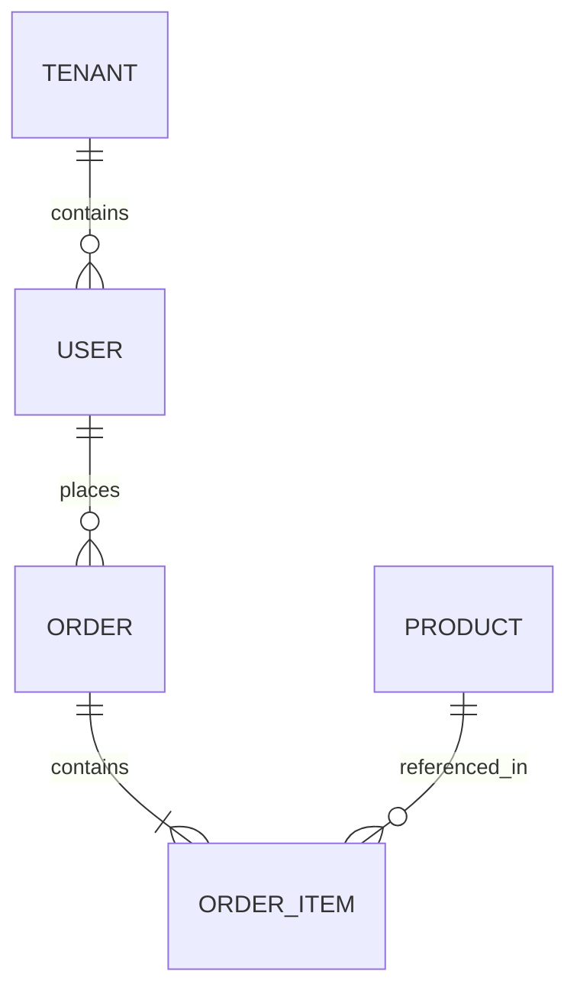

# Technical Requirements Document (TRD.md)

> **Artefacto Canónico**: `TRD.md`  
> **Basado en**: `PRD.md`, `APP_FLOW.md` y `DESIGN_SYSTEM.md`  
> **Estado**: Aprobado  
> **Versión**: 1.0.0  

---

## 1. Visión Técnica y Selección de Stack

- **Stack Tecnológico Seleccionado**:
  - *Runtime / Lenguaje*: [ej. TypeScript en Node 22 / Bun / Go]
  - *Frontend / UI*: [ej. Next.js 15 / React 19 / Vite + Tailwind 4], guiado por `DESIGN_SYSTEM.md`
  - *Backend / API*: [ej. Fastify / Express / Hono], arquitectura modular limpia
  - *Persistencia*: [ej. PostgreSQL con Drizzle / Prisma / SQL nativo], transacciones ACID
  - *Mensajería / Realtime*: [ej. SSE / WebSockets / Redis PubSub] (cuando aplique)
- **Justificación de Arquitectura**: [Por qué esta combinación satisface los NFRs definidos en `PRD.md`].

---

## 2. Arquitectura de Módulos y Capas

```
src/
├── modules/
│   ├── [feature-a]/
│   │   ├── domain/        # Entidades, tipos e interfaces core (independiente de framework)
│   │   ├── application/   # Casos de uso y orquestación de reglas de negocio
│   │   ├── infrastructure/# Adaptadores de DB, clientes externos y repositorios
│   │   └── presentation/  # Controladores HTTP, routers o vistas UI
└── shared/
    ├── config/            # Variables de entorno validadas con Zod
    ├── errors/            # Clases de error de dominio estructuradas
    └── middleware/        # Auth, logging, correlación y rate-limiting
```

- **Patrones de Separación**:
  - Inversión de Dependencias (DIP) entre casos de uso y acceso a datos.
  - Cero dependencias circulares; schemas Zod compartidos entre capas.

---

## 3. Esquema de Datos y Modelo de Entidades

### 3.1 Diagrama Entidad-Relación (Mermaid)



### 3.2 Definición de Entidades Clave
- **Tabla / Modelo**: `[NombreEntidad]`
  - Campos, tipos, restricciones `NOT NULL`, claves foráneas e índices de alto rendimiento (`btree`, `gin`).
  - Estrategia de migraciones e idempotencia.

---

## 4. Contratos de API, Eventos y Errores

### 4.1 Endpoints Core
- `POST /api/v1/[recurso]`
  - **Headers**: `Idempotency-Key` (UUIDv4), `Authorization: Bearer <token>`
  - **Payload (Zod Schema)**:
    ```typescript
    export const CreateResourceSchema = z.object({
      title: z.string().min(1).max(120),
      // ...
    });
    ```
  - **Respuestas**:
    - `201 Created`: `{ data: { id, status, createdAt } }`
    - `400 / 422 Unprocessable`: `{ error: { code: "VALIDATION_FAILED", details: [] } }`
    - `401 Unauthorized` / `403 Forbidden`

---

## 5. Seguridad, Rendimiento e Infraestructura (`NFR-*`)

- **Seguridad**: Sanitización de entradas, tokens de sesión seguros (cookies httpOnly, SameSite=Lax), control de acceso basado en roles (RBAC).
- **Rendimiento**: Presupuesto de latencia p95 < 250ms, índices de base de datos en claves de búsqueda frecuente, compresión gzip/brotli.
- **Observabilidad**: Logs estructurados con `requestId` / correlación distribuida, métricas de latencia y health check `/healthz`.

---

## 6. Matriz de Trazabilidad Canónica

| Requisito PRD (`FR-#`) | Ruta (`APP_FLOW.md`) | Componente (`DESIGN_SYSTEM.md`) | Endpoint API (`TRD.md`) | Unidad de Trabajo ODD (`T#`) |
|---|---|---|---|---|
| `FR-01` | `/login` | `LoginForm` / `Input` | `POST /api/v1/auth/login` | `T1` |
| `FR-02` | `/dashboard` | `DashboardView` / `Card` | `GET /api/v1/dashboard/metrics` | `T2` |
| `FR-03` | `/orders/new` | `CheckoutView` / `Button` | `POST /api/v1/orders` | `T3` |
