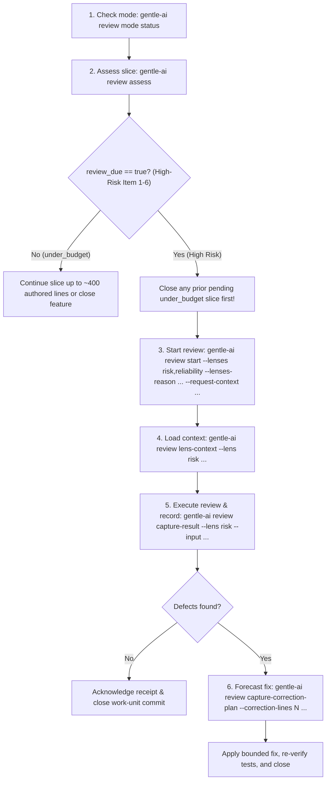

# 🛡️ Gentle-AI Review 4R — Proportionate Native Review & RDD Facade

Operational guide for the **Gentle-AI 5.0.0** native review facade (`gentle-ai review`, Review Integration `v2` / Capabilities `v1.5`, Go module `/v5`). Canonical lifecycle rules live in [`_shared/review-ledger-contract.md`](../../_shared/review-ledger-contract.md). Replaces rigid line-count gates and small-model verifier bias with **risk-proportionate 4R lens selection**, isolated high-risk slices, **a unified `review-due` decision** across Stop hooks and review entry, single-route lineage abandonment (`gentle-ai review abandon`), `--request-context` / `--target-evidence` binding, and cryptographically bound receipt lineage when RDD is enabled.

---

## 🚫 Core Invariants (Gentle-AI 5.0.0 / Review Integration `v2`)

1. **USER-OWNED AUTHORITY (ON BY DEFAULT) & GRACEFUL FALLBACK**: RDD is enabled by default in `5.0.0` and strictly user-owned (`gentle-ai review mode disable --scope global|clone` to opt out, or `enable --scope global` to re-enable). Never enable or disable RDD autonomously. When `gentle-ai review mode status` reports disabled, operate under ordinary repository policy (`disabled/unmanaged`). When the `gentle-ai` binary is absent or the repository is on an unsupported SMB/UNC network path (`\\server\share`), report `receipt-driven development: unavailable` and continue under ordinary repository policy.
2. **HIGH-RISK ONLY & UNIFIED `review_due`**: `gentle-ai review assess` flags `review_due: true` **only** when the candidate is high risk (`items 1..6`). In `5.0.0`, Stop hooks read the exact same `review-due` decision as the review entry path, compact `v2` is the sole ordinary review lifecycle (while read-only `legacy-v1` compatibility and `review repair --preflight` remain available for inspecting damaged/legacy authority), and explicit `--escalate-item <1-6> --escalate-reason "<why>"` always reaches review entry.
3. **ISOLATED HIGH-RISK SLICES**: Before committing a unit whose `Risk:` line names any High-Risk Item (`1..6`), **close and review any pending `under_budget` slice first**, then give the high-risk unit its own isolated commit and review cycle.
4. **NO SMALL-MODEL VERIFIER BIAS**: Independent verification is triggered strictly by high-risk classification (`--escalate-item <1-6> --escalate-reason "<why>"`), never because a smaller or faster model authored the change.
5. **SINGLE BOUNDED CORRECTION TRANSACTION**: When a review reports actionable defects, forecast correction size with `capture-correction-plan --correction-lines <N>` (`N > 0`, plus binding tokens from STATUS) **before** editing source files. Use `gentle-ai review abandon` for operator abandonment of stuck lineages, and `gentle-ai review repair --preflight` to inspect damaged authority.

---

## 🔍 The 4R Review Lenses & Proportionate Selection

At `gentle-ai review start`, the agent selects the exact lenses matching the candidate's risk surface via `--lenses <list>` (`risk`, `resilience`, `readability`, `reliability`) and documents the rationale with `--lenses-reason "<text>"` (plus `--request-context <file>` and `--target-evidence <value>`):

| Lens ID | CLI Lens Value (`--lenses`) | Lens Name | Focus Surface | When to Select |
|---|---|---|---|---|
| **`R1`** | `risk` | **Risk & Security** | Auth, permissions, secrets, injection, sandboxing, data loss, migrations | Any touch to High-Risk Items 1 (data/migrations) or 2 (security/guards) |
| **`R2`** | `readability` | **Readability & Maintainability** | Naming clarity, cognitive complexity, dead code, idiomatic structure | Refactorings, complex domain logic, or multi-module structural changes |
| **`R3`** | `reliability` | **Reliability & Contracts** | Public APIs, CLI flags, shared parsers/helpers, schema invariants, test coverage | Touching shared code (Item 3), concurrency/async ordering (Item 4), or untested paths (Item 6) |
| **`R4`** | `resilience` | **Resilience & Rollback** | Failure recovery, timeouts, CI/CD, installers, backward compatibility, clean revert | Delivery/environment changes (Item 5), external I/O, or stateful migrations |

---

## 🔄 Native Review Lifecycle Workflow (`review-integration/v2`)



### Canonical CLI Sequence

```bash
# 1. Inspect current RDD mode, capabilities (5.0.0 / v1.5), and base-ref preflight state
gentle-ai review capabilities
gentle-ai review mode status
gentle-ai review status --contract gentle-ai.review-integration/v2 --next-transition

# 2. Assess current diff / candidate risk
gentle-ai review assess --escalate-item 3 --escalate-reason "Modifies shared frontmatter parser consumed by router and validator"

# 3. Start proportionate 4R review (CLI lens names: risk, resilience, readability, reliability)
gentle-ai review start \
  --lenses "risk,reliability" \
  --lenses-reason "Shared YAML parser touches untrusted input handling (risk) and cross-tool AST contract (reliability)" \
  --request-context odd/tasks/current-feature.md

# 4. Retrieve bounded lens context for the reviewer subagent (passing verbatim collect tokens)
gentle-ai review lens-context --cwd . --repository-context <handle> --lineage <id> --target <sha256> --expected-revision <sha256> --lens risk
gentle-ai review lens-context --cwd . --repository-context <handle> --lineage <id> --target <sha256> --expected-revision <sha256> --lens reliability

# 5. Capture structured review verdict (`gentle-ai review schema reviewer` prints the strict JSON shape)
gentle-ai review capture-result --cwd . --repository-context <handle> --lineage <id> --target <sha256> --expected-revision <sha256> --lens risk --input <result.json>

# 6. If a bounded correction is required before approval (using verbatim binding tokens):
gentle-ai review capture-correction-plan --cwd . --repository-context <handle> --lineage <id> --target <sha256> --expected-revision <sha256> --request-hash <sha256> --correction-lines 28
# (If a lineage gets stuck or exceeds correction budget, abandon explicitly with --actor;
#  run `gentle-ai review abandon` with no flags to print the exact 8-line binding template)
gentle-ai review abandon --lineage <id> --expected-revision <rev> --actor <operator> --maintainer-authorization <binding> --reason operator_disposition
```

---

## ⚠️ High-Risk Items (`1..6`) & Escalation Matrix

Every code change must close with `Risk: item N (<reason>)` or `Risk: none`. Any item `1..6` triggers mandatory independent verification and `review_due`:

1. **Item 1 — Data / Irreversible Effects**: Schema migrations, modifying/deleting persisted records, storage format changes.
2. **Item 2 — Security**: Authentication, authorization, credentials, secrets, sandboxes, trust boundaries.
3. **Item 3 — Shared Contracts**: Public APIs, CLI flags, config schemas, published exports, or shared helpers/parsers used by existing behaviors the prompt did not mention.
4. **Item 4 — Concurrency**: Locks, race conditions, worker synchronization, async ordering guarantees.
5. **Item 5 — Delivery / Environment**: Installers, CI pipelines, release scripts, container images, runtime dependencies.
6. **Item 6 — Untested Surface**: Changes where no automated test would catch a behavioral regression.

---

## ⚖️ Before & After: Legacy Gate vs Gentle-AI 5.0.0 4R Review

| ❌ Legacy / Dogmatic Review | ✅ Gentle-AI 5.0.0 Proportionate 4R Review |
|---|---|
| Forces full 4-lens review on a 180-line low-risk docs/test update | `review assess` reports `under_budget`; zero unnecessary subagent overhead |
| Mixes a 300-line routine refactor with a 40-line auth guard change in one commit | Closes the `under_budget` refactor slice first; isolates the Item 2 auth change in its own commit with `--lenses risk,reliability` |
| Launches an independent verifier solely because a fast model wrote a 10-line CSS fix | Escalates to independent verifier **only** when High-Risk Items `1..6` apply |

---

## 🚀 Floor, Not Ceiling (`[Beyond-Baseline]`)

The native `gentle-ai review` lifecycle defines the baseline governance contract. Teams and agents may extend verification depth when the domain warrants it (`[Beyond-Baseline: <reason>]`):

- **Adversarial Dual-Judge Escalation (`judgment-day`)**: For critical Item 1 (financial/data migrations) or Item 2 (cryptographic/auth boundary) changes, combine `gentle-ai review` (`risk,reliability,resilience`) with two blind adversarial review agents to eliminate single-reviewer blind spots (`[Beyond-Baseline: Dual-blind adversarial security audit]`).
- **Differential Benchmark Receipts**: Pair `R3`/`R4` reviews on hot-path parsers or query engines with automated `mktemp -d` base-vs-head latency benchmarks attached to the review evidence (workers must report any `mktemp -d` paths created so the parent orchestrator cleans them up before task closure).
