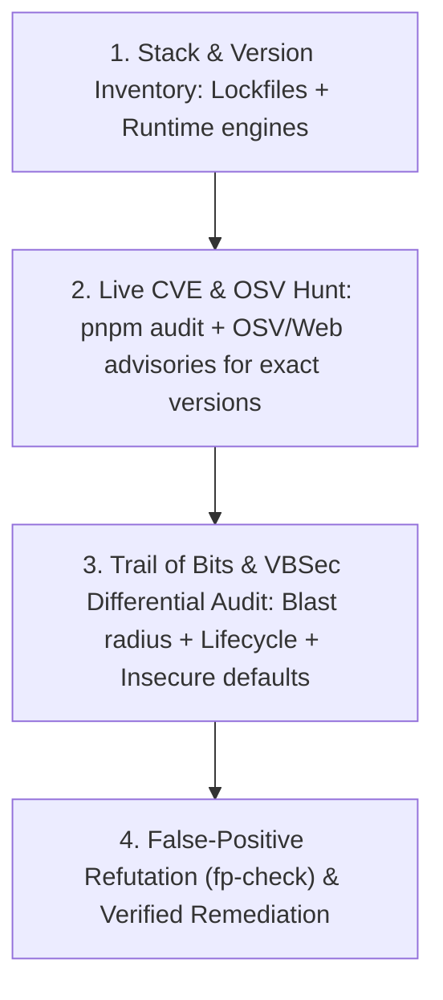

# 🛡️ Live CVE Threat Intelligence & Differential Security Audit

Defensive security skill synthesizing **Trail of Bits** (`differential-review`, `insecure-defaults`, `fp-check`, variant analysis), **Ghost Security** (Poltergeist secrets, Wraith OSV SCA, Exorcist SAST, Reaper runtime validation), **VBSec** (AI vibe-coding vulnerability patterns), and a mandatory **End-of-Project Live CVE & Lifecycle Gate**.

---

## 🚫 Hard Invariants (Defensive Only — Non-Negotiable)

1. **STRICT DEFENSIVE ETHICS**: This skill exists exclusively to harden user repositories, verify reachability of defects, and prevent vulnerabilities. Never generate weaponized exploits targeting external systems.
2. **NO UNVERIFIED STATIC-VERSION ASSUMPTIONS**: Training-data cutoffs miss newly disclosed AI-discovered vulnerabilities. Before project closure or release, actively query live advisories (`pnpm audit`, OSV.dev, GitHub Security Advisories, or `search_web`) for the exact runtime and package versions in `package.json`, `Cargo.toml`, `pyproject.toml`, `composer.json`, or `go.mod`.
3. **MANDATORY FALSE-POSITIVE REFUTATION (`fp-check`)**: Never report a speculative SAST alert without tracing data flow from an untrusted source (`req`, webhook, file, CLI arg) to a sensitive sink and confirming no upstream guard neutralizes it.
4. **WORKER & OOM LIFECYCLE CLEANUP**: Long-lived workers (Node/Bun/Go servers, PHP-FPM/FrankenPHP, Python ASGI) must reset request-scoped state in `finally` blocks and isolate fatal/OOM aborts so tainted globals never bleed into the next request (modeled on the Oct 2026 **PHP2Shell** `CVE-2026-109618` & `CVE-2026-109619` wave).

---

## 🔄 The 4-Phase Pre-Release Security & Live CVE Protocol



### Phase 1: Exact Stack & Runtime Inventory
Extract exact pinned versions from lockfiles (`pnpm-lock.yaml`, `composer.lock`, `uv.lock`, `go.sum`, `Dockerfile` base images) and runtime engines (`Node`, `PHP`, `Python`, `Go`, `PostgreSQL`, `Redis`).

### Phase 2: Live CVE & AI-Discovered Vulnerability Hunting
1. Run native ecosystem advisories first:
   ```bash
   pnpm audit --prod
   ```
2. Query live web/OSV advisories for the project's core framework and runtime versions (`"<framework/runtime> <version> CVE 2026 security advisory"`).
3. **Lifecycle & Memory-Boundary Audit (The Post-2026 AI CVE Lesson)**:
   - AI-assisted vulnerability discovery increasingly uncovers **state-cleanup, OOM recovery, parser differential, and integer/buffer boundary flaws** (e.g., `CVE-2026-109618` where an out-of-memory abort skipped per-request variable table teardown in persistent worker processes).
   - Verify that worker pools, singleton caches, and request contexts never retain user-controlled state across aborted or timed-out requests.

### Phase 3: Trail of Bits, Ghost Security & VBSec Differential Review
Audit changed and security-critical surfaces against these four defensive lenses:

| Lens | Source Methodology | High-Priority Defect Patterns to Hunt |
|---|---|---|
| **Differential & Variant Analysis** | **Trail of Bits** (`differential-review`) | Auth checks added to one route/handler while sibling routes (`PUT`/`DELETE`/GraphQL/Server Actions) remain unguarded; broken invariants in shared parsers (ODD High-Risk Item 3). |
| **Insecure Defaults & Crypto** | **Trail of Bits** (`insecure-defaults`) | Fallback secrets (`process.env.JWT_SECRET \|\| 'dev-secret'`), permissive CORS (`*` with credentials), weak hashes, unverified webhook signatures, `alg: none` or non-constant-time token checks. |
| **Vibe-Coding Blind Spots** | **VBSec** & **Claude Cybersecurity** | Hallucinated middleware (defined but never mounted), client-side-only RBAC checks, IDOR/BOLA (`WHERE id = $1` without `AND tenant_id = $2`), TOCTOU race conditions in balance/quota updates (`SELECT` then `UPDATE` without transaction/atomic lock), SSRF in URL previewers/AI fetch tools. |
| **4-Pillar Reachability** | **Ghost Security** (`Exorcist`/`Wraith`/`Poltergeist`) | 1. **Secrets** in git history/logs; 2. **SCA** reachable vulnerable functions (not just unused transitive deps); 3. **SAST** source-to-sink taint paths; 4. **Runtime/DAST** boundary verification. |

### Phase 4: `fp-check` Refutation Gate & Output Format
Before flagging any finding as a blocker, verify:
1. **Attacker Control**: Can an unauthenticated or low-privilege actor control the input?
2. **Guard Absence**: Are schema validators (Zod), ORM parameter bindings, or middleware guards bypassed?
3. **Exploitability & Impact**: Does the path cross a real trust boundary?

Report findings with `Severity (Critical/High/Medium)`, `Location (path:line)`, `Causal Source-to-Sink Trace`, `Live CVE/CWE ID`, and `Minimal Remediation Diff`.

---

## 🧭 Floor, Not Ceiling (`[Beyond-Baseline]`)

This skill sets the mandatory pre-release security floor. Agents are encouraged to propose stronger architectural defenses when the threat model warrants it (`[Beyond-Baseline: <security reason>]`):
- **Row-Level Security (RLS) + Branded Tenant Types**: Enforce tenant isolation at both the TypeScript type level (`TenantId` branded type) and PostgreSQL RLS level so IDOR becomes structurally impossible (`[Beyond-Baseline: Defense-in-depth RLS + branded types]`).
- **Ephemeral Worker Isolation**: Configure process recycle limits or per-request V8/Wasm isolates for untrusted file/template parsing (`[Beyond-Baseline: Blast-radius containment against parser/OOM CVEs]`).
