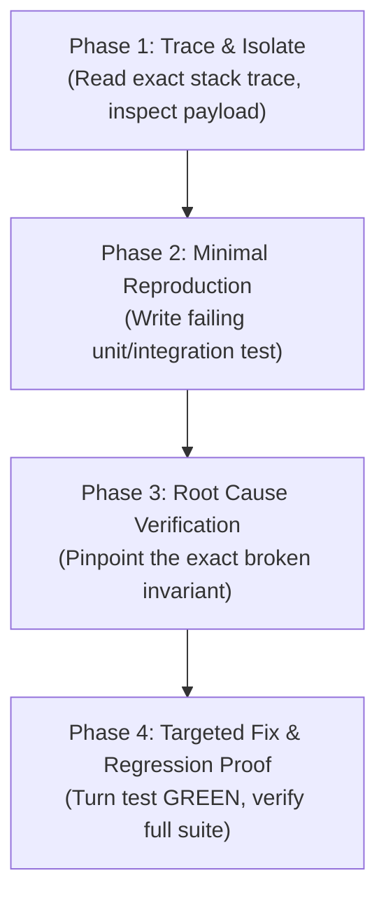

# 🔍 Systematic Debugging: Root Cause Protocol

**Core principle:** ALWAYS isolate and prove the root cause before attempting fixes. Symptom fixes and speculative code changes are strictly forbidden.

---

## 🚫 Absolute Bans

| Anti-Pattern | Why It Is Banned | Enforced Alternative |
|---|---|---|
| **Speculative Guessing ("Shotgun Fixes")** | Applying random changes without proving causality creates phantom bugs and masks regressions. | Follow the 4-phase protocol: inspect traces, reproduce minimally, and verify root cause. |
| **Symptom Patching / Band-aids** | Adding null checks (\`val ?? ''\`) or empty try/catch blocks hides underlying corrupt state. | Identify why the state was invalid or null upstream and correct the source invariant. |
| **Silent Error Swallowing** | \`try { ... } catch {}\` without logging or telemetry makes production debugging impossible. | Either handle and recover predictably, or log structured telemetry and rethrow. |
| **Fixing Without a Reproducing Test** | Claiming a fix without an automated test allows immediate regression in subsequent commits. | Write a minimal failing test (RED) that isolates the bug before changing production code. |
| **Multi-Variable Changes** | Tweaking several files simultaneously obscures which change actually resolved the bug. | Apply one minimal atomic modification at a time and observe test output. |

---

## 🧭 The 4-Phase Debugging Protocol

### Phase 1: Trace & Invariant Isolation
1. **Read the Full Error**: Never skim stack traces. Note exact file paths, line numbers, and error codes.
2. **Trace Causal Inputs**: What exact data triggered the exception? Trace parameters up the call stack.

### Phase 2: Minimal Reproduction
1. Extract the minimal input required to trigger the failure.
2. Formulate a standalone unit or integration test reproducing the exact error (observe **RED**).

### Phase 3: Root Cause Verification
1. Formulate a single testable hypothesis: *"This fails because X expects Y, but Z produced W."*
2. Confirm the hypothesis through inspection or debug logging.

### Phase 4: Targeted Fix & Regression Gate
1. Implement the minimal fix addressing the root invariant (observe **GREEN**).
2. Refactor if needed while keeping tests green.
3. Run the complete test suite to ensure zero collateral regressions.

---

## 📊 Before & After Debugging Patterns

### 1. Handling Null Reference Errors

**❌ Anti-Pattern (Symptom Band-aid):**
\`\`\`typescript
// Bad: Suppressing symptom with defensive fallback, masking corrupt database state
export function getCustomerCity(customer: any): string {
  try {
    return customer.address.city || 'Unknown';
  } catch {
    return 'Unknown'; // Silently masks missing address relation in query
  }
}
\`\`\`

**✅ Approved Pattern (Root Cause Resolution with Regression Test):**
\`\`\`typescript
// 1. Minimal failing test proves query omitted relation:
it('loads customer with address relation to prevent undefined city', async () => {
  const customer = await customerRepository.findById('cust-1');
  expect(customer?.address).toBeDefined();
  expect(customer?.address.city).toBe('Caracas');
});

// 2. Fix the root cause in the repository query:
export async function findById(id: string): Promise<Customer | null> {
  return db.customer.findUnique({
    where: { id },
    include: { address: true }, // Root cause: missing eager include
  });
}
\`\`\`

---

## 📋 Closure Verification Checklist
- [ ] Automated regression test committed alongside the fix.
- [ ] Root cause documented in the commit message (`fix(scope): resolve root cause description`).
- [ ] Full project test suite passes cleanly with zero warnings.
