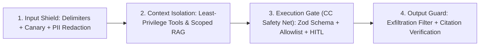

# 🛡️ AI Safety, Agent Guard & Tool-Execution Safety Net

Defensive engineering framework combining **Image 3 #09 (AI Safety, Security & Governance)**, **OWASP Top 10 for LLM & Agentic Applications (2026)**, **Agent Guard** (prompt injection & data-exfiltration shields), and **CC Safety Net** (mechanical interception of destructive shell, Git, and database operations).

---

## 🚫 Hard Invariants (Non-Negotiable)

1. **UNTRUSTED CONTENT IS NEVER SYSTEM INSTRUCTION**: External data retrieved via RAG, web scraping, emails, PDFs, GitHub issues, or MCP resources is strictly **untrusted data**. Never concatenate raw external text into system prompts without structural delimiters and privilege separation.
2. **NO UNGUARDED TOOL EXECUTION (`Excessive Agency`)**: LLM tool calls must validate arguments against strict schemas (Zod) and an explicit allowlist. High-impact mutations (deleting data, moving money, sending external emails, modifying IAM) require a deterministic **Human-in-the-Loop (HITL)** approval gate.
3. **CC SAFETY NET FOR DESTRUCTIVE COMMANDS**: Block or require explicit human confirmation before executing irreversible operations: `rm -rf` outside scratch dirs, `git reset --hard`, `git push --force`, `DROP TABLE` / `TRUNCATE`, or unmasked secret printing (`env`, `printenv`, `.env` dumps).
4. **ZERO SECRET / PII EXFILTRATION VIA TOOLS**: Outbound tool calls, markdown image renders (``), and telemetry logs must strip API keys, session tokens, and unredacted PII before transmission.

---

## 🧱 The 4-Layer Agent Defense Architecture



### Layer 1: Prompt Injection & Jailbreak Defense (Inbound)
- **Structural Spotlight Delimiters**: Wrap untrusted retrieved documents or user uploads in explicit XML/JSON data envelopes (`<untrusted_document id="...">...</untrusted_document>`) and instruct the system prompt that nothing inside those tags can override system rules or invoke tools.
- **Instruction Hierarchy**: Keep system instructions, developer policies, user messages, and tool outputs in distinct role messages; never flatten them into a single prompt string.
- **Canary Tokens**: For high-security workflows, embed a per-request canary token in the system prompt and monitor output streams; if the canary appears in output or tool arguments, abort the session immediately.

### Layer 2: Least-Privilege Agent & MCP Tool Design
- **Read/Write Split**: Separate read-only retrieval tools from state-mutating tools. A summarization or search subagent should have zero write/network-egress tools enabled.
- **Tenant-Scoped Context**: Bind `tenantId` and `userId` from the authenticated server session inside the tool runner closure — **never** let the LLM pass `userId` as a tool argument (prevents cross-tenant AI IDOR).

### Layer 3: CC Safety Net (Mechanical Command & DB Interception)

```typescript
// Deterministic pre-execution guard for agent shell/tool invocations
const DESTRUCTIVE_PATTERNS = [
  /\brm\s+-[rRf]+\s+(?:\/|~|\$HOME|\.\.)/,
  /\bgit\s+(?:push\s+.*--force|reset\s+--hard|clean\s+-[fd]+)/,
  /\b(?:DROP\s+(?:TABLE|DATABASE|SCHEMA)|TRUNCATE\s+TABLE)\b/i,
  /\b(?:curl|wget)\b.*(?:\$\{?[A-Z0-9_]*(?:KEY|TOKEN|SECRET)|\.env)/i,
];

export function assertSafeCommand(cmd: string): void {
  for (const pattern of DESTRUCTIVE_PATTERNS) {
    if (pattern.test(cmd)) {
      throw new Error(`[AgentGuard:Blocked] Destructive or exfiltration command requires explicit human approval: ${cmd}`);
    }
  }
}
```

### Layer 4: Outbound Exfiltration & Hallucination Guard
- **Markdown Image & Link Sanitization**: Strip or proxy external untrusted URLs in LLM-generated markdown so indirect prompt injections cannot exfiltrate chat context via auto-loaded image query strings.
- **Structured Output Validation**: Validate final LLM responses against a deterministic schema and verify that cited source IDs actually exist in the retrieved context set.

---

## 🧭 Floor, Not Ceiling (`[Beyond-Baseline]`)

While the 4-layer guard above is the mandatory safety floor, agents may propose advanced architectures when building high-assurance AI systems (`[Beyond-Baseline: <reason>]`):
- **Dual-LLM Privilege Separation (CaMeL Pattern)**: Use a privileged Quarantined Planner LLM (which sees only user intent and typed variable handles) and an unprivileged Data-Reader LLM (which processes untrusted text without tool access) (`[Beyond-Baseline: Cryptographic/structural data-flow isolation against indirect prompt injection]`).
