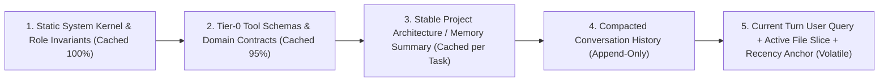

# 🧠 Context Engineering (2026) — Architecture for High-Signal Agentic Context

Context Engineering is the discipline of curating, ordering, caching, and compacting the exact token payload delivered to an LLM at each inference step. Even with 1M+ token context windows, **attention is a scarce quadratic resource**: stuffing uncurated files, 80+ tool schemas, or raw terminal logs degrades reasoning accuracy ("context rot") and destroys KV-cache hit rates.

---

## 🚫 Context Anti-Patterns (Non-Negotiable Bans)

1. **NO DYNAMIC TIMESTAMPS IN SYSTEM PROMPTS**: Injecting `new Date().toISOString()` or per-turn counters at the top of the system prompt invalidates the entire KV prefix cache on every turn, multiplying TTFT (Time-To-First-Token) and inference cost by 5x–10x.
2. **NO UNBOUNDED TOOL SCHEMA DUMPS**: Loading >25 full MCP/tool JSON schemas eagerly into every turn pollutes attention and causes tool-selection hallucinations. Use **Two-Tier Progressive Disclosure**.
3. **NO CRITICAL INVARIANTS BURIED IN THE MIDDLE**: Transformer attention follows a U-shaped curve (primacy and recency bias). Never bury safety constraints or output contracts in the middle of a 50k-token payload.
4. **NO RAW STDOUT/LOG FLOODING**: Never pipe unfiltered test suites, build logs, or 2,000-line files into parent agent context; bound outputs to summaries, `--stat`, or delegated subagent handoffs (<= 2k tokens).

---

## 🏗️ 1. KV-Cache Optimal Prefix Ordering

Structure every prompt payload from **most static** (byte-identical across turns and sessions) to **most volatile** (per-turn state) to maximize automatic and explicit prefix caching:



### Implementation Pattern (TypeScript)

```typescript
export interface ContextFrame {
  staticSystemKernel: string;      // Byte-identical across all turns (NO timestamps!)
  tier0ToolDefinitions: unknown[]; // Deterministic key ordering (JSON canonicalized)
  projectMemoryDigest: string;     // Updated only on task boundary / compaction
  turnHistory: Array<{ role: "user" | "assistant"; content: string }>;
  activeWorkspaceSlice: string;    // Bounded path:line slices + current clock if needed
  recencyChecklist: string;        // Critical output & safety invariants repeated at tail
}

export function assembleCachedPayload(frame: ContextFrame) {
  return [
    { role: "system" as const, content: frame.staticSystemKernel, cacheControl: { type: "ephemeral" } },
    { role: "system" as const, content: frame.projectMemoryDigest, cacheControl: { type: "ephemeral" } },
    ...frame.turnHistory,
    {
      role: "user" as const,
      content: `${frame.activeWorkspaceSlice}\n\n---\n### Mandatory Turn Invariants\n${frame.recencyChecklist}`,
    },
  ];
}
```

---

## 🧭 2. Two-Tier Progressive Disclosure

Divide knowledge and tool definitions into two strict tiers so the active context window stays lean:

| Tier | Token Budget | Contents | Loading Mechanism |
|---|---|---|---|
| **Tier 0 (Always-On Kernel)** | `<= 2,048 tokens` | Core workflow protocol (ODD), hard safety rules, and compact catalog index | Injected at session start (`AGENTS.md` / system prompt) |
| **Tier 1 (On-Demand Specialists)** | `<= 5 skills / turn` | Full domain guides, specialized schemas, reference examples | Loaded dynamically via deterministic router (`skill-router`) or lazy MCP schema read |
| **Tier 2 (Deep Reference / Cold Storage)** | `0 tokens until queried` | Historical ADRs, full API specs, past session transcripts | Retrieved via CodeGraph (`codegraph_explore`), Engram (`mem_search`), or bounded `Read` |

---

## 📉 3. Mitigating Attention Decay ("Lost in the Middle")

When context exceeds 30k–50k tokens, models exhibit measurable recall drops for constraints located between 25% and 75% of the prompt length:

- **Primacy Zone (Top 10%)**: Place identity, core security boundaries, and routing triggers.
- **Middle Zone (10%–85%)**: Place retrieved code snippets, reference documentation, and historical turns—always tagged with explicit `path:startLine-endLine` citations so the model can anchor references.
- **Recency Zone (Bottom 15%)**: Place the current user instruction, active test failure output, and a concise **Recency Anchor** (3–5 bullet checklist of non-negotiable output requirements such as `Risk:` line and verification commands).

---

## 🗜️ 4. Structured Compaction & Subagent Handoff Protocol

Never let a conversation degrade until hard truncation drops the earliest instructions. Compact proactively (at ~65% of effective reasoning budget or ~120k–150k tokens) using a **Lossless State Envelope**:

```markdown
## Compacted Session State Envelope
- **Objective & Spec Locator**: `odd/tasks/feature-x.md` (Tasks T1-T2 complete, T3 active)
- **Verified Commits & Evidence**: `a1b2c3d` (`pnpm test` 42/42 green)
- **Locked Architectural Decisions**: Using Hono + Drizzle over Express; tokens in HTTP-only cookies
- **Failed Approaches (Do Not Repeat)**: Regex YAML parsing failed on folded scalars `>`; use `splitFrontmatter`
- **Active Open Blockers**: `src/router.ts:88` needs NFD diacritic normalization before T3 closes
```

### Subagent Context Isolation
- Delegate broad exploration (`> 5` sequential file lookups) to a read-only research subagent.
- The subagent absorbs 40k+ tokens of raw search noise in its disposable context and returns a **<= 2,000-token structured handoff** with exact `path:line` evidence to the parent orchestrator.

---

## ⚖️ Before & After: Context Architecture

| ❌ Naive Prompt Stuffing | ✅ Engineered Context Pipeline |
|---|---|
| Injects current timestamp and random UUID in line 1 of system prompt (0% cache hit) | Keeps system prefix 100% static; appends runtime metadata in the final user turn (>90% cache hit) |
| Dumps 230 skills and 60 MCP tool schemas into every turn (~85k tokens baseline) | Loads ~1.5k-token Tier-0 kernel + top `<= 5` routed Tier-1 skills on demand |
| Summarizes history into vague prose that forgets commit hashes and file paths | Compacts into a structured State Envelope preserving exact specs, hashes, and negative findings |

---

## 🚀 Floor, Not Ceiling ([Beyond-Baseline])

This skill defines the baseline architecture for prompt caching, progressive disclosure, and compaction. Exceed the baseline when building advanced agentic systems (`[Beyond-Baseline: <reason>]`):

- **Token-Budget Telemetry & Auto-Eviction**: Instrument agent loops with real-time `cached_tokens / prompt_tokens` hit-rate telemetry and automatic TTL eviction of stale file reads after 3 turns (`[Beyond-Baseline: Automated KV-cache telemetry & slice eviction]`).
- **AST-Sliced Context Assembly**: Use `codegraph_explore` to assemble only the exact caller/callee AST nodes and type signatures needed for a task instead of loading whole source files.
