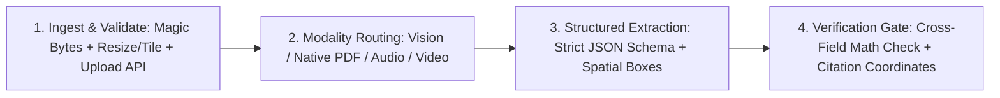

# 👁️🎙️ Multimodal AI Pipelines — Vision, Audio, Video & Structured Grounding

Production patterns for **Image 3 #06 (Multimodal AI)**. Covers native vision/document understanding, spatial bounding-box grounding, low-latency audio/speech pipelines, intelligent video frame/token budgeting, and deterministic cross-modal schema extraction.

---

## 🚫 Hard Invariants (Security, Cost & Integrity Floor)

1. **STRICT MIME, MAGIC-BYTE & SIZE VALIDATION**: Never forward arbitrary user uploads directly to multimodal model APIs. Verify magic bytes (`%PDF-`, PNG/JPEG/WebP/WAV/MP4 headers), enforce strict byte limits, and strip EXIF GPS/PII metadata when privacy requires it.
2. **NATIVE MULTIMODAL PDF/IMAGE OVER BRITTLE OCR**: For complex tables, invoices, charts, and multi-column PDFs, prefer passing native page images or PDF buffers to a vision-capable model with a **strict Zod / JSON Schema** rather than chaining lossy regexes over legacy plaintext OCR.
3. **BOUNDED MEDIA TOKEN BUDGETS**: Never upload un-tiled 8K images or raw 2-hour 4K videos without downscaling/sampling. Resize images to optimal model tile bounds (`<= 1536px–2048px` longest edge) and sample video at `1 fps` (or scene-change keyframes) unless high-frequency motion analysis is required.
4. **CROSS-MODAL CONFIDENCE & HUMAN REVIEW GATE**: For high-stakes extractions (medical records, financial invoices, legal contracts), require the schema to emit per-field `confidence` + `page_number`/`bounding_box` coordinates and route low-confidence fields to human review.

---

## 🏗️ The 4 Core Multimodal Pipeline Patterns



### 1. Document & Vision Extraction with Deterministic Invariant Checks
Combine visual layout understanding with programmatic post-validation (e.g., verifying that `sum(lineItems) + tax === totalAmount`):

```typescript
import { z } from "zod";

export const DocumentExtractionSchema = z.object({
  documentType: z.enum(["invoice", "receipt", "contract", "id_card"]),
  currency: z.string().length(3),
  lineItems: z.array(
    z.object({
      description: z.string(),
      quantity: z.number(),
      unitPrice: z.number(),
      lineTotal: z.number(),
      pageNumber: z.number().int().min(1),
      boundingBoxNormalized: z.tuple([z.number(), z.number(), z.number(), z.number()]).optional(), // [ymin, xmin, ymax, xmax] 0..1000
    })
  ),
  subtotal: z.number(),
  tax: z.number(),
  totalAmount: z.number(),
  extractionConfidence: z.enum(["high", "medium", "needs_human_review"]),
});

export function verifyInvoiceMath(data: z.infer<typeof DocumentExtractionSchema>): boolean {
  const computedSum = data.lineItems.reduce((acc, item) => acc + item.lineTotal, 0);
  return Math.abs(computedSum + data.tax - data.totalAmount) < 0.02;
}
```

### 2. Spatial Grounding & UI Visual Verification
- Request normalized bounding boxes (`[ymin, xmin, ymax, xmax]` scaled `0..1000`) when locating defects, diagrams, or form fields in images/screenshots.
- Render interactive SVG highlight overlays over the source document in the frontend so users can visually verify every extracted value in one click.

### 3. Video & Long-Context Media Processing
- **File API / Signed URI Upload**: For media `> 10–20 MB`, stream uploads through the provider's File API / Object Storage URI rather than base64-encoding giant buffers in JSON request bodies.
- **Temporal Grounding**: Require video analysis prompts to return `mm:ss` timestamp ranges (`startTime`, `endTime`) alongside every detected event or transcript segment.

### 4. Audio & Real-Time Voice Pipelines
- Pair low-latency WebSocket audio streaming (see `gemini-live-api-dev` when using Gemini Live) with Voice Activity Detection (VAD), barge-in interruption handling, and server-side transcript persistence.

---

## 🚀 Floor, Not Ceiling (`[Beyond-Baseline]`)

Agents may extend these pipelines (`[Beyond-Baseline: <reason>]`) with **Dual-Pass Visual Verification** (cropping high-resolution sub-regions around detected bounding boxes for a second micro-OCR pass on dense schematics or fine print) or **Multimodal RAG** (indexing both visual page embeddings and structured markdown summaries per page).
