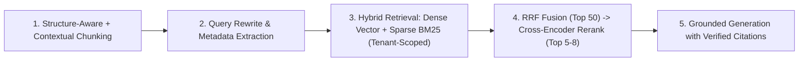

# 📚 RAG & Knowledge Systems — Hybrid Retrieval, Reranking & Grounding

Production architecture for **Image 3 #04 (RAG & Knowledge Systems)**. Replaces naive fixed-character splitting and top-k cosine lookups with **structure-aware contextual chunking, hybrid BM25 + dense vector retrieval, Reciprocal Rank Fusion (RRF), cross-encoder reranking, and strict citation/tenant grounding**.

---

## 🚫 Hard Invariants (Security & Grounding Floor)

1. **PRE-FILTER BY TENANT ACL BEFORE VECTOR SEARCH**: Never run global vector similarity and filter permissions in application memory afterward. Every vector/BM25 query MUST include a mandatory database-level `WHERE tenant_id = $1` (or metadata pre-filter) to prevent cross-tenant data leakage.
2. **UNTRUSTED CHUNK DELIMITATION (`ai-safety-agent-guard`)**: Retrieved chunks are untrusted external data. Wrap injected context in `<document id="..." source="...">...</document>` tags so indirect prompt injections inside user PDFs/docs cannot hijack system instructions.
3. **ZERO UNGROUNDED HALLUCINATIONS**: Require the generation step to emit inline source citations (`[doc_id]`) and provide an explicit `"insufficient_evidence"` fallback when retrieved context does not answer the query.
4. **EMBEDDING MODEL VERSION PINNING**: Persist the `embedding_model` and `dimensions` alongside vectors so model migrations never mix incompatible vector spaces.

---

## 🔄 The 5-Stage Production RAG Pipeline



### Stage 1: Structure-Aware & Contextual Chunking
- **Never split mid-sentence or mid-table**: Parse documents by AST/structural boundaries (Markdown headings, HTML sections, PDF layout blocks, code AST functions). Keep tables and code blocks intact.
- **Contextual Retrieval Header (Anthropic Pattern)**: Prepend a concise 1–2 sentence document-level context header (`[Doc: Q3 Billing Policy | Section: Enterprise Refunds]`) to each chunk before computing embeddings and BM25 tokens. This reduces retrieval failure on pronoun-heavy or isolated chunks by >35%.
- **Recommended Chunk Budget**: `300–600` tokens per chunk with `10–15%` semantic overlap, storing parent document IDs for small-to-big parent window expansion.

### Stage 2: Hybrid Search (Dense Embeddings + Lexical BM25)
Dense embeddings capture semantic synonyms, while BM25 captures exact SKUs, error codes (`ERR_4091`), function names, and proper nouns. Combine both using **Reciprocal Rank Fusion (RRF)** with $k = 60$:

$$\text{RRF\_Score}(d) = \frac{1}{k + \text{rank}_{\text{vector}}(d)} + \frac{1}{k + \text{rank}_{\text{bm25}}(d)}$$

```sql
-- Canonical PostgreSQL (pgvector + tsvector) Tenant-Scoped Hybrid RRF Query
WITH vector_matches AS (
  SELECT id, content, source_uri,
         ROW_NUMBER() OVER (ORDER BY embedding <=> $2::vector) AS r_vec
  FROM knowledge_chunks c
  WHERE c.tenant_id = $1
  LIMIT 40
),
lexical_matches AS (
  SELECT id, content, source_uri,
         ROW_NUMBER() OVER (ORDER BY ts_rank_cd(search_tsv, websearch_to_tsquery('simple', $3)) DESC) AS r_lex
  FROM knowledge_chunks c
  WHERE c.tenant_id = $1 AND NULLIF(trim($3), '') IS NOT NULL AND c.search_tsv @@ websearch_to_tsquery('simple', $3)
  LIMIT 40
)
SELECT COALESCE(v.id, l.id) AS id,
       COALESCE(v.content, l.content) AS content,
       COALESCE(v.source_uri, l.source_uri) AS source_uri,
       COALESCE(1.0 / (60 + v.r_vec), 0.0) + COALESCE(1.0 / (60 + l.r_lex), 0.0) AS rrf_score
FROM vector_matches v
FULL OUTER JOIN lexical_matches l ON v.id = l.id
ORDER BY rrf_score DESC
LIMIT 25;
```

### Stage 3: Cross-Encoder Reranking & Context Compression
Pass the top `20–30` RRF candidates through a dedicated reranker (e.g., Cohere Rerank, BGE-Reranker, or Voyage Rerank) and inject only the top `5–8` chunks passing a minimum relevance threshold into the LLM prompt.

---

## 🚀 Floor, Not Ceiling (`[Beyond-Baseline]`)

While Hybrid RRF + Reranking is the production baseline, agents may propose advanced architectures when the domain requires multi-hop reasoning (`[Beyond-Baseline: <reason>]`):
- **GraphRAG / Entity-Relationship Subgraphs**: Extract entities and edges into a property graph alongside vector chunks to answer global corpus questions or multi-hop compliance queries.
- **Agentic Corrective RAG (CRAG)**: Add a lightweight relevance-evaluator step that rewrites the query or triggers a live documentation lookup when initial chunk relevance scores fall below threshold.
