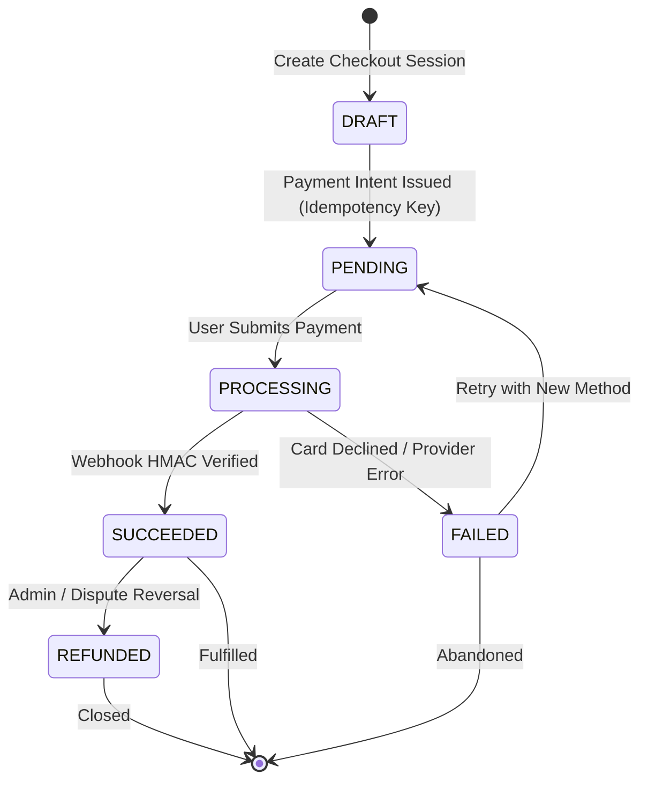

# 💳 Universal Payment Processing Architecture

Standardized, secure architecture for digital transactions, subscription billing, and multi-gateway payment processing.

---

## 🏛️ Core Architectural Lifecycle



---

## 🔒 Hard Invariants (Non-Negotiable)

1. **Idempotency Key Protection**:
   - Every mutation creating a charge or payment intent MUST require an `Idempotency-Key` (UUIDv4) passed in headers or transaction payload.
   - Prevent duplicate debit when network retries occur.
2. **Cryptographic Webhook Verification**:
   - Webhook endpoints MUST verify the cryptographic signature (HMAC-SHA256) using the provider secret and the raw request body buffer *before* reading or parsing event payloads.
   - Protect against replay attacks by enforcing a timestamp tolerance window (typically ≤ 5 minutes).
3. **Zero Raw Card Data (PCI-DSS Compliance Floor)**:
   - NEVER touch or store raw card numbers (PAN), expiration dates, or CVV/CVC codes on application servers.
   - Always tokenize on the client via provider SDKs (Stripe Elements, MercadoPago Secure Fields, PayPal SDK) and pass tokenized payment method IDs to backend services.
4. **State Machine Transitions via Webhook Only**:
   - Client redirect URLs (`success_url`, `return_url`) are for user presentation only.
   - Authoritative order completion, entitlement granting, and balance updates MUST occur exclusively upon processing verified webhook events inside an atomic database transaction.

---

## 🧩 Decoupled Provider Adapter Pattern

Abstract specific gateways behind a uniform domain interface:

```typescript
export interface PaymentIntentParams {
  amount: number; // In smallest currency unit (e.g. cents)
  currency: string; // ISO 4217 (usd, eur, ves, etc.)
  customerId: string;
  idempotencyKey: string;
  metadata: Record<string, string>;
}

export interface PaymentAdapter {
  createPaymentIntent(params: PaymentIntentParams): Promise<{ intentId: string; clientSecret: string }>;
  verifyWebhook(rawBody: Buffer, signature: string): Promise<{ eventType: string; data: Record<string, unknown> }>;
  refund(paymentId: string, amount?: number): Promise<{ refundId: string; status: 'SUCCEEDED' | 'PENDING' }>;
}
```

---

## 📂 Adapters & References

| Provider / Region | File Reference | When to Load |
|---|---|---|
| **Universal Base & Database** | `../../04-backend/postgresql/SKILL.md` | Schema design and ACID transactions for orders and payments |
| **Venezuela Regional Adapter** | [`references/regional-venezuela.md`](references/regional-venezuela.md) | Multi-currency USD/VES, official BCV rate caching, Pago Móvil C2P, and Cashea BNPL |
| **Real-time Payment Notifications** | `../../04-backend/socketio/SKILL.md` | Emitting payment confirmation to client UI |

---

## 🚀 Floor, Not Ceiling

> [!TIP]
> This skill defines the reliability floor for financial transactions (idempotency, webhook verification, state machine integrity). Agents are explicitly encouraged to leverage provider-specific advanced capabilities (e.g., Stripe Billing, Radar fraud prevention, automatic tax calculations, Apple Pay / Google Pay sheets) when beneficial to the project requirements.
