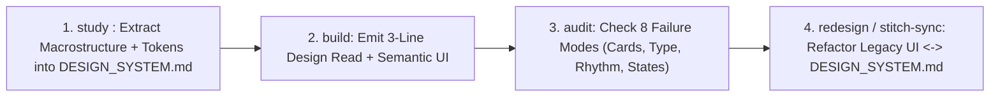

# 🏛️ Hallmark Design Study, Ethical DNA Extraction & Stitch Sync

Harmonized adaptation of **Nutlope/hallmark** (Together AI's 4-verb anti-slop system), **Website Cloner** (structural DNA extraction), and **Google Labs `stitch-skills`** (`DESIGN_SYSTEM.md` <-> code synchronization). Integrated with `design-driven` (D1b) and `taste-skill` so all frontend skills share one token contract and zero rule conflicts.

---

## 🚫 Hard Invariants (Floor)

1. **ETHICAL STRUCTURAL EXTRACTION ONLY**: When running `study` or cloning a reference layout, extract **abstract design DNA** (grid proportions, typographic scale ratios, OKLCH luminance polarity, spacing rhythm, and motion curves). **Never** copy copyrighted brand logos, proprietary copywriting, or trademarked illustrations.
2. **UNIFIED `DESIGN_SYSTEM.md` & 3-LINE `DESIGN READ`**: Every output must emit the 3-line `Design Read` (or 1-line Fast-Path) and map extracted tokens to `--surface-*`, `--text-*`, `--accent-*`, and `--border-*` in `DESIGN_SYSTEM.md`.
3. **ZERO FAUX-DENSITY OR DUMMY DATA**: Never populate extracted layouts with `Lorem ipsum`, fake sparklines, or decorative non-functional controls.

---

## 🧭 The 4 Hallmark Verbs & Stitch Sync Workflow

### 1. `study <url | screenshot | reference>` (Ethical Website DNA Extraction)
Deconstruct any admired reference interface into 5 transferable layers and write them into `DESIGN_SYSTEM.md`:
- **Layer 1 — Macrostructure**: Identify the primary spatial architecture (*Editorial Split 1:3*, *Bento Telemetry Matrix*, *Pinned Canvas + Floating HUD*, *Command-First Workbench*, or *Monumental Gallery*).
- **Layer 2 — Luminance & OKLCH Polarity**: Extract surface elevation steps (`--surface-0` to `--surface-3`), border contrast mechanism (hairline `1px` vs negative-space separation), and primary accent chroma.
- **Layer 3 — Typographic Voice**: Capture display-to-body scale ratio (`clamp()`), tracking (`-0.03em` on headlines), and numeric discipline (`tabular-nums`).
- **Layer 4 — Spatial Rhythm**: Document container max-width, column count, and section padding cadence.
- **Layer 5 — Signature Micro-Interaction**: Capture the defining hover/focus/transition physics.

### 2. `build` (Macrostructure-First Creation)
Choose a deliberate macrostructure instead of defaulting to "hero banner + 3 equal feature cards":
- **Editorial Monograph**: Sticky table-of-contents rail + deep long-form technical canvas with inline interactive demos.
- **Live Instrument First**: Drop the user directly into an interactive playground, calculator, or command surface above the fold.
- **Asymmetric Proof Grid**: Pair one primary interactive artifact (`8 cols`) with verifiable telemetry/benchmarks (`4 cols`).

### 3. `audit` & `redesign` (Eliminating the 5 Hallmark Failure Modes)
When auditing or redesigning an existing screen, systematically replace:
1. **Equal-Card Disease** -> Replace 3-4 identical bordered boxes with a unified hairline table, a featured primary panel + compact list, or open typographic columns.
2. **Flat Type Hierarchy** -> Introduce high-contrast size jumps (`clamp(2.25rem, 4.5vw, 4rem)` vs `0.9375rem`) and monospace metadata labels.
3. **Hardcoded Hex Chaos** -> Refactor raw Tailwind colors (`bg-slate-800`, `#3b82f6`) into semantic tokens (`var(--surface-1)`, `var(--accent-primary)`).
4. **Missing Interactive States** -> Add explicit `focus-visible`, `active`, `disabled`, `loading`, and `empty` states.
5. **Stitch Bidirectional Sync (`stitch-sync`)**: When a component evolves during implementation, sync newly discovered token refinements back into `DESIGN_SYSTEM.md` so documentation and code never drift.

---

## 🚀 Floor, Not Ceiling (`[Beyond-Baseline]`)

Designers and agents are encouraged to hybridize studied references (`[Beyond-Baseline: <creative synthesis>]`) — for example, combining the typographic discipline of a financial terminal with the tactile warmth of an archival print catalog under Archetype H (`Think Outside the Box`).
