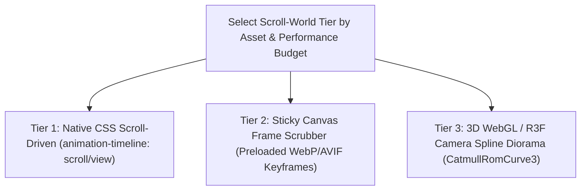

# 🌍 Scroll-World Storytelling & Design-to-Motion Choreography

Harmonized adaptation of **oso95/scroll-world** (scroll-scrubbed 3D/video/canvas worlds) and **elayadesign/ai-design-skills** (`design-to-motion` choreography). Aligned with `design-driven` Archetypes **C (`The Gallery`)**, **D (`The Kinetic Utility`)**, and **H (`Bespoke / Think Outside the Box`)**, and `emil-kowalski` motion physics.

---

## 🚫 Hard Invariants (Performance & Accessibility Floor)

1. **MANDATORY `prefers-reduced-motion` FALLBACK**: Every scroll-scrubbed canvas, WebGL camera rig, or parallax timeline MUST detect `@media (prefers-reduced-motion: reduce)` and degrade gracefully to a clean static keyframe layout with instant chapter navigation.
2. **60/120FPS GPU COMPOSITING ONLY**: Never animate layout-thrashing properties (`top`, `left`, `width`, `height`, `margin`, `filter: blur()` on large areas) on scroll ticks. Animate only `transform` (`translate3d`, `scale`, `rotate`), `opacity`, WebGL uniforms, or `<canvas>` `drawImage` buffers via `requestAnimationFrame`.
3. **UNIFIED `DESIGN READ` & SEMANTIC TOKENS**: Declare the 3-line `Design Read` before coding and bind HUD overlays, chapter markers, and typography to `DESIGN_SYSTEM.md` tokens (`--surface-*`, `--text-*`, `--accent-*`).
4. **ZERO SCROLL HIJACKING TRAPS**: Never trap the user's native scrollbar in an inescapable wheel listener or break keyboard `PageDown`/`Space`/`Tab` navigation.

---

## 🎬 The 3 Scroll-World Architectures



### Tier 1: Native CSS Scroll-Driven Choreography (Zero-JS Overhead)
Prefer modern CSS `animation-timeline: view()` / `scroll()` for progressive reveals, sticky card stacks, and horizontal track pinning before reaching for heavy JS libraries:
```css
@media (prefers-reduced-motion: no-preference) {
  .scroll-stage {
    view-timeline-name: --stage-timeline;
    view-timeline-axis: block;
  }
  .scroll-actor {
    animation: actor-reveal linear both;
    animation-timeline: --stage-timeline;
    animation-range: entry 10% cover 45%;
  }
}
```

### Tier 2: Sticky `<canvas>` Keyframe Sequence Scrubber (Apple Product Showcase Style)
When showcasing hardware, industrial products, or complex visual transformations:
1. **Sticky Stage Container**: Pin a `100dvh` `<canvas>` inside a `300vh–500vh` scroll track (`position: sticky; top: 0`).
2. **Progressive Frame Preloading**: Load Frame 0 immediately as an LCP poster image, then preload remaining frames (`60–120` WebP/AVIF frames) in chunks off the main thread (`createImageBitmap`).
3. **Damped Scroll Interpolation**: Map normalized scroll progress $p \in [0, 1]$ to `frameIndex = Math.min(totalFrames - 1, Math.floor(p * totalFrames))` inside a single `requestAnimationFrame` loop, redrawing only when `frameIndex !== lastFrameIndex`.

### Tier 3: 3D WebGL / Three.js Camera Spline Diorama (`scroll-world`)
When building a navigable 3D world or spatial architecture showcase:
- Define camera waypoints along a smooth `CatmullRomCurve3` spline with paired `lookAt` targets per chapter (`0.0 -> Hero`, `0.35 -> Exploded View`, `0.70 -> Internal Telemetry`, `1.0 -> CTA`).
- Synchronize HTML chapter HUD overlays (`pointer-events: none` on container, `pointer-events: auto` on interactive buttons) with scroll progress intervals so text enters at $p_a$, holds, and exits cleanly at $p_b$.
- Pause the WebGL render loop via `IntersectionObserver` whenever the canvas scrolls out of the viewport.

---

## 🚀 Floor, Not Ceiling (`[Beyond-Baseline]`)

While the 4 invariants above guarantee accessibility and 60fps smoothness, agents are encouraged to push creative boundaries (`[Beyond-Baseline: <motion thesis>]`) — such as interactive shader uniforms driven by scroll velocity or hybrid 3D-to-editorial transitions where a 3D model seamlessly docks into a technical spec-sheet table.
