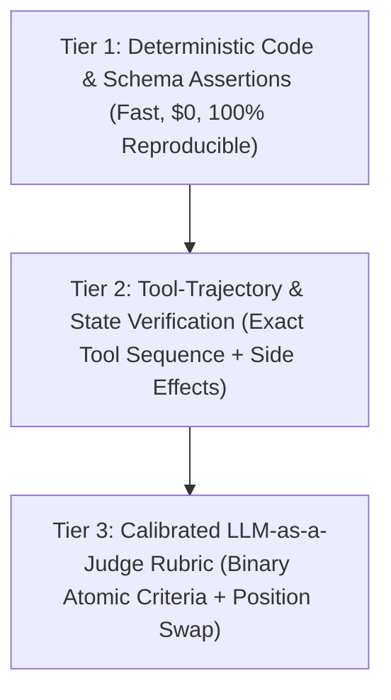

# 🎯 Agentic Evals & Eval-Driven Development (EDD)

**Eval-Driven Development (EDD)** is the AI-engineering equivalent of TDD: before modifying a system prompt, tool schema, RAG chunker, or skill router, define a measurable **Golden Dataset** and a **3-Tier Grading Pipeline**, observe the baseline score (RED/Baseline), implement the change, and prove zero regressions with quantified precision, recall, latency, and token cost (GREEN).

---

## 🚫 Non-Negotiable EDD Bans

1. **NO "VIBES-BASED" PROMPT SHIPPING**: Never ship a prompt, router heuristic, or tool-schema change based on 2 manual chat tests ("it looked good to me"). Run the golden eval suite and record before/after metrics.
2. **NO UNCALIBRATED 1-TO-10 LLM JUDGES**: Never ask an LLM judge to *"rate this response from 1 to 10"*. Unanchored numeric scales have high variance. Use **binary (`PASS`/`FAIL`) or 3-point atomic criteria rubrics** with explicit pass conditions.
3. **NO SINGLE-ORDER PAIRWISE JUDGING**: LLM judges exhibit strong **position bias** (favoring the first option shown). When running A/B pairwise comparisons, swap order `(A, B)` and `(B, A)`; require consistency or flag a tie.
4. **NO MISSING NEGATIVE / ADVERSARIAL CASES**: Every eval dataset must include at least **25% negative/adversarial cases** (queries that should *not* trigger a tool, prompt-injection attempts, or out-of-scope requests) to measure false-positive rate (Precision), not just Recall.

---

## 🏗️ 1. The 3-Tier Agentic Grading Pyramid

Always grade with the cheapest, most deterministic tier first, escalating to LLM-as-a-Judge only for open-ended semantic quality:



| Grading Tier | What It Verifies | Determinism | Cost & Speed | Example Assertion |
|---|---|---|---|---|
| **Tier 1: Code / Structural** | Valid JSON/YAML, Zod schema match, regex invariants, exact skill/route ID, latency/token ceiling | 100% | `$0` / `<5ms` | `assert.equal(route.primary, "jwt-bcrypt")` |
| **Tier 2: Trajectory & State** | Which tools were called, in what order, with what arguments, and resulting DB/filesystem state | 100% (mocked tools) | Low / `<100ms` | Verify `codegraph_explore` was called *before* `edit_file` |
| **Tier 3: Calibrated Judge** | Factual grounding against retrieved context, tone, completeness, absence of hallucination | ~92–97% (with temperature `0`) | Model API cost | Binary rubric check: *"Does the answer cite only paths present in context?"* |

---

## 📋 2. Golden Dataset Curation Schema

Store golden datasets in version-controlled JSON/JSONL files alongside tests (`evals/datasets/<suite>.json`), stratified across **4 mandatory buckets**:

1. **Happy Path (40%)**: Canonical user queries with clear expected tool/output targets.
2. **Edge & Multilingual Cases (20%)**: Typos, missing accents (`"autenticacion"` vs `"autenticación"`), punctuation traps (`PRD.md`, `node.js`, `socket.io`).
3. **Negative Controls / Exclusion Clauses (25%)**: Queries that share keywords but belong to a different domain (verifies `Do NOT use for...` boundaries).
4. **Adversarial / Safety Probes (15%)**: Prompt injections, secret-exfiltration requests, or destructive command bait.

```typescript
// evals/run-router-eval.ts
import assert from "node:assert/strict";

export interface EvalCase {
  id: string;
  bucket: "happy" | "edge" | "negative" | "adversarial";
  input: string;
  expectedPrimary: string | null;
  forbiddenSkills?: string[];
  maxTokens?: number;
}

export interface EvalSummary {
  total: number;
  passed: number;
  precision: number;
  recall: number;
  f1: number;
  regressions: string[];
}

export function evaluateSuite(cases: EvalCase[], runner: (q: string) => { primary: string | null }): EvalSummary {
  let tp = 0, fp = 0, fn = 0, passed = 0;
  const regressions: string[] = [];

  for (const c of cases) {
    const actual = runner(c.input).primary;
    const match = actual === c.expectedPrimary;
    if (match) {
      passed++;
      if (c.expectedPrimary !== null) tp++;
    } else {
      regressions.push(`${c.id}: expected ${String(c.expectedPrimary)}, got ${String(actual)}`);
      if (actual !== null && c.expectedPrimary === null) fp++;
      if (actual === null && c.expectedPrimary !== null) fn++;
      if (actual !== null && c.expectedPrimary !== null) { fp++; fn++; }
    }
  }

  const precision = tp + fp === 0 ? 1 : tp / (tp + fp);
  const recall = tp + fn === 0 ? 1 : tp / (tp + fn);
  const f1 = precision + recall === 0 ? 0 : (2 * precision * recall) / (precision + recall);
  assert.ok(f1 >= 0.9, `Eval F1 ${f1.toFixed(3)} dropped below 0.90 gate`);
  return { total: cases.length, passed, precision, recall, f1, regressions };
}
```

---

## ⚖️ 3. Calibrated LLM-as-a-Judge Protocol

When Tier 1 and Tier 2 cannot grade free-form reasoning, enforce a **Calibrated Binary Rubric** at `temperature: 0`:

- **Decompose into Atomic Boolean Checks**: Instead of one holistic score, evaluate 3–4 independent `boolean` questions (`groundedInSources`, `respectsNegativeConstraints`, `actionableNextStep`).
- **Require Evidence Quotes First (Chain-of-Thought Before Verdict)**: Force the judge schema to output `evidenceQuote: string` and `reasoning: string` **before** `pass: boolean` so token generation conditions the verdict on cited evidence.
- **Calibrate Against Human Labels**: Maintain a 20-item human-labeled calibration set; verify the judge model achieves `>= 90%` agreement with human labels before trusting it in CI.

---

## ⚖️ Before & After: Ad-Hoc Prompting vs EDD

| ❌ Ad-Hoc Prompt Tweaking | ✅ Eval-Driven Development (EDD) |
|---|---|
| Tweaks system prompt to fix 1 bug, silently breaking 4 other tool routes | Runs 100-case stratified eval suite; catches any regression before commit |
| Uses an uncalibrated LLM judge: *"Score helpfulness 1-10"* (noisy, flaky CI) | Uses Tier-1 deterministic assertions + Tier-2 trajectory checks + binary atomic rubrics |
| Only tests queries that *should* trigger the agent | Includes 25% negative controls and 15% adversarial probes to guard Precision |

---

## 🚀 Floor, Not Ceiling ([Beyond-Baseline])

This skill defines the baseline EDD methodology for prompts, routers, and agent trajectories. Go beyond baseline for production AI systems (`[Beyond-Baseline: <reason>]`):

- **Production Trace-to-Eval Flywheel**: Automatically sample production agent failures, thumbs-down turns, or RDD review corrections, anonymize PII, and append them to the golden regression dataset (`[Beyond-Baseline: Automated production failure harvesting]`).
- **Pareto Cost-Accuracy Frontier Tracking**: Plot each candidate prompt/model across a 3D Pareto frontier (`F1 Accuracy` vs `P95 Latency ms` vs `Cost per 1k runs`) so architectural upgrades demonstrably improve quality per dollar.
