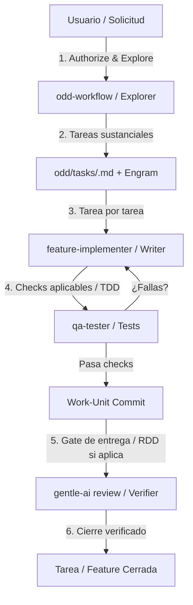

# AGENTS.md — Skill System (Portable 2026, pnpm)

Este archivo guía a los agentes de IA (Claude Code, Cursor, OpenCode, Copilot, Codex) que trabajan con esta colección de skills. Las skills son agnósticas al proyecto: úsalas en cualquier monorepo.

## 📂 Categorías de Skills

| Categoría | Path | Skills |
|---|---|---|
| Planning & Process | `01-planning-process/` | project-tracker, tech-stack-advisor, application-workflow, master-prompt, agents, engram-integration, speckit-integration, session-notes, parallelization, tech-escalation-adr, idea-to-prd-express, jira-epic, jira-task, brainstorming, cognitive-doc-design, lean-ux, brand-guidelines, content-strategy, copywriting, humanizer, storybrand-messaging, content-studio |
| Dev Roles (SDD) | `02-dev-roles/` | architecture-designer, code-reviewer, dod-checker, expert-debugger, security-audit, feature-implementer, frontend-designer, frontend-design, judgment-day, decision-gate, github-pr, performance-refactor, qa-tester, technical-writer, hexagonal-architecture-layers-java, systematic-debugging, verification-before-completion, jd-judge-a, jd-judge-b, jd-fix-agent, review-risk, review-readability, review-reliability, review-resilience, review-refuter, review-validator, rdd-defect-workflow, auth-flow-audit, frontend-debugging-protocol, micro-interactions, archify |
| AI / ML | `03-ai-ml/` | ai-orchestration, ai-scalability-mlops, api-ai-billing, llm-integration, ai-sdk-5, prompt-engineering, research-first |
| Backend | `04-backend/` | docker, error-handling, mcp-integration, api-design, expressjs, jwt-bcrypt, microservices, nodejs, payments, postgresql, prisma-orm, socketio, django-drf, java-21, spring-boot-3, api-response-normalizer, background-jobs-queues, booking-scheduling-domain, file-uploads-storage, nodejs-module-loading, notifications-multichannel, prisma-frontend-types, rate-limiting-design, reports-exports |
| Frontend | `05-frontend/` | electronjs, electron, expo-production-auditor, maps-gps, nextjs, nextjs-15, push-notifications, pwa-capacitor, react-native, react-vite, react-19, ai-ui-generation, tailwindcss, tailwind-4, zod-4, zustand-5, angular-core, angular-forms, angular-performance, angular-architecture, state-management, vercel-react-best-practices, vercel-composition-patterns, vercel-react-view-transitions, web-design-guidelines, interface-design, figma-implement, three-js-web, web-animation-sources, design-driven, impeccable, taste-skill, deep-linking-mobile, design-system-tokens, forms-validation-react, i18n-localization, lazy-loading-patterns, lottie-animations, motion-accessibility, motion-framer, motion-gsap, offline-sync-mobile, page-transitions, scroll-animations, visual-effects, emil-kowalski, refactoring-ui, ui-ux-pro-max, onboarding-cro, page-cro, popup-cro, signup-flow-cro |
| Code Quality | `06-code-quality/` | pnpm-workspaces, turborepo, biome, changesets, env-management, solid-clean-code, typescript, dependency-guardian, elixir-antipatterns, changelog-generator, branch-pr, chained-pr, comment-writer, issue-creation, systemic-issue-triage, work-unit-commits, build-config-validator |
| Testing | `07-testing/` | testing-patterns, playwright, pytest, go-testing |
| DevOps | `08-devops/` | ci-cd, kill-switches, monitoring, observability, store-deployment-eas, cloudflare-edge |
| Media & Graphics | `09-media-graphics/` | nano-banana, banana-claude |
| MCP Hybrids | `11-mcp-hybrid/` | component-scrapper-mcp, oklch-theme-injector, motion-video-pipeline, ux-auditor-agent, asset-generator-mcp, figma-mcp, open-design, gentle-ai-bench, openseo |
| SDD Planning | `professional-planner/` | professional-planner |
| Meta-Skills | `00-meta-skills/` | catalog-usage, skill-creator, skill-sync, skill-validator, skill-router, skill-loader, sdd-orchestrator, sdd-init, sdd-explore, sdd-research, sdd-propose, sdd-spec, sdd-design, sdd-tasks, sdd-apply, sdd-verify, sdd-archive, sdd-onboard, skill-harvest, gentle-orchestrator, agent-roster, find-skills, skill-improver, skill-registry, catalog-doctor, skill-spector, odd-workflow |
| Matt Pocock | `12-matt-pocock/` | ask-matt, code-review, codebase-design, diagnosing-bugs, domain-modeling, grill-me, grill-with-docs, grilling, handoff, implement, improve-codebase-architecture, migrate-to-shoehorn, prototype, research, resolving-merge-conflicts, scaffold-exercises, setup-pre-commit, tdd, teach, to-questionnaire, to-spec, to-tickets, triage, wait-what, wayfinder, wizard, writing-for-agents |

## 🚀 Regla de arranque (harness) — v3, alineada a gentle-ai 4.0.0

> **Modelo de capas (lección del bench 2026-09-18)**: un agente solo sigue lo que vive en su capa always-on (system prompt). Los lineamientos guardados en archivos que hay que decidir leer (`AGENTS.md`, `SKILLS.md`, `.agents/rules/*`) no se leen en corridas autónomas. Por eso el activador del catálogo es un **kernel** que el instalador inyecta en los archivos que cada harness autocarga — no una regla que dependa de la buena voluntad del agente.

1. **Kernel siempre activo**: `node install.mjs --target <repo>` inyecta el bloque `skillsGV:kernel` (variantes `_shared/bootstrap-kernel-full.md` para harnesses desnudos, `-minimal.md` cuando gentle-ai está activo) en `AGENTS.md` / `GEMINI.md` / `CLAUDE.md` según el harness detectado, escribe el `.gitignore` de las rutas instaladas y registra todo en `.skills-install/manifest.json`. Verificá la activación con `references/canary-activation.md`.
2. **ODD exclusivo (gentle-ai 4.0)**: desde gentle-ai 4.0, Organic Driven Development (ODD) es la única vía de desarrollo. El flujo SDD y los subcomandos `sdd-status`/`sdd-continue` fueron retirados upstream. El agente ejecuta ODD directamente; en harnesses sin binario gentle-ai, la skill `odd-workflow` opera como fallback estructurado.
3. **Protocolo ODD por tarea**: Cada cambio autorizado sigue: Authorize → Explore → Resolve uncertainty → Classify → Feature Doc (`odd/tasks/<feature>.md` + espejo Engram `odd/<feature>/tasks`) → Tarea a tarea con work-unit commits en feature branch → Close.
4. **Superficie NL-primero**: pedir un cambio en lenguaje natural es la vía primaria. El agente rutea autónomamente mediante ODD y las herramientas de memoria/revisión de gentle-ai 4.0.

## 🧭 La Tríada + memoria (matriz de responsabilidades)

El catálogo aporta la gobernanza cognitiva; el binario aporta la mecánica determinista (congelamiento, recibos, presupuestos).

| Pilar | Pregunta | Dónde vive |
|---|---|---|
| ODD | ¿Qué construyo y cómo? | `00-meta-skills/odd-workflow` (Authorize → Explore → Tasks) |
| TDD | ¿Cómo pruebo que funciona? | `07-testing/testing-patterns` (RED/GREEN aplicable) |
| RDD | ¿Es seguro entregar? | binario `gentle-ai` (recibos/gates) + `02-dev-roles/rdd-defect-workflow` + lentes `review-*` |
| Engram | ¿Qué aprendimos? | `01-planning-process/engram-integration` (mem_save/mem_session_summary) |

## 🔄 Ciclo de Desarrollo (Flujo ODD con Verificación Proporcional)



1. **Exploración y Clasificación:** El agente explora el código existente antes de escribir nada. Si la tarea requiere 2+ pasos significativos, genera automáticamente `odd/tasks/<feature-name>.md` y su espejo Engram antes del primer write.
2. **Construcción y Tests (TDD):** Implementación atómica tarea por tarea, aplicando RED/GREEN cuando existan tests deterministas ejecutables.
3. **Work-unit Commits:** Cada tarea cierra con al menos un commit convencional en feature branch registrando la evidencia en el documento de tareas.
4. **Verificación y Entrega:** Verificación proporcional al riesgo (lectura estructural, auto-verificación del writer o verificador independiente) y evaluación RDD/presupuesto de review (~400 líneas).

## 🚦 Reglas Globales (con Don't/Do pareados)

- **Nunca** almacenar JWT en LocalStorage/AsyncStorage. **Usar**: access tokens en memoria (variable de módulo), refresh tokens en HTTP-only cookies con flag `Secure` y `SameSite=Strict`.
- **Nunca** procesar payloads de Socket.io sin validar. **Usar**: esquemas Zod compartidos en `packages/contracts/` antes de cualquier lógica de negocio.
- **Nunca** usar `any` en TypeScript. **Usar**: `unknown` + narrowing con Zod, o tipos explícitos del dominio.
- **Package manager: pnpm only — npm/npx rechazados.** **Nunca** correr `npm` ni `npx` en comandos, docs o skills. **Usar**: `pnpm` para instalar/scripts y `pnpm dlx` como reemplazo de `npx`. El validador (`validate-skills.mjs --strict`) marca las menciones de `npm`/`npx` como ERROR; una skill que deba mencionarlos por una razón documentada declara `allows-npm: <motivo>` en su frontmatter.
- **Nunca arrancar código nuevo sin explorar lo existente (ODD)**. Todo trabajo entra en ODD (Organic-Driven Development): explorar → resolver incertidumbre → clasificar → feature doc en `odd/tasks/<feature>.md` + espejo Engram si es sustancial → tarea por tarea con work-unit commits. Las skills antiguas de SDD están deprecadas y redirigen a `odd-workflow`.
- **Siempre** usar `pnpm expo install` para paquetes móviles nativos. **Nunca** `pnpm add` directo, ya que rompe la compatibilidad con el SDK de Expo. Validar después con `dependency-guardian`.
- **Siempre** correr `pnpm expo prebuild --clean` antes de un EAS build. **Usar**: la skill `expo-production-auditor` para auditar 4 frentes (circular deps, Hermes, assets, sync de deps nativas).
- **Siempre** registrar decisiones arquitectónicas y bugs complejos. **Usar**: la skill `tech-escalation-adr` para ADRs y `expert-debugger` para postmortems.
- **Stack base recomendado**: Node/Express/Prisma/PostgreSQL + React/Vite/Tailwind + Expo Router. Cualquier cambio o adición al stack debe proponerse mediante un ADR de la skill `tech-escalation-adr`.
- **Siempre** guardar decisiones, bugs y descubrimientos en Engram al vuelo (`mem_save`, topic keys `<proyecto>/…`, `design/<proyecto>`); al cerrar sesión `mem_session_summary`; ante conflictos `mem_judge`. "Guardado en memoria" NO es "respondido al usuario": confirmá en el chat.
- **Siempre** al cierre de cada proyecto (después de TODOS los fixes): correr el protocolo `skill-harvest` (buscar en Engram lo aprendido → 1-3 patrones repetibles → TXT en `_inbox`). Nunca crear la skill automáticamente — recomendarla.
- **Traductor visual**: si el usuario manda capturas/imágenes y el modelo no ve imágenes, no improvisar — redirigir a Antigravity (u `od`) y exigir spec textual.
- **Presupuesto de review (400/800)**: por defecto 400 líneas cambiadas por PR (`additions + deletions`; generados/goldens fuera del conteo de riesgo); al excederlo, consultar la estrategia de entrega con `ask-on-risk` (cadena/apilado vs `size:exception`). El techo de preflight por usuario es 800 líneas.

## 🤖 Auto-Invoke List (root)

Cuando el agente detecte las siguientes acciones, **debe** cargar la skill correspondiente ANTES de actuar.

> **Two-tier loading (PrD blindaje):**
> - **Tier 0 (siempre cargadas, 14 skills, ~2K tokens):** `skill-router`, `skill-validator`, `skill-creator`, `skill-sync`, `skill-loader`, `odd-workflow`, `idea-to-prd-express`, `agents`, `project-tracker`, `session-notes`, `engram-integration`, `decision-gate`, `kill-switches`, `dod-checker`.
> - **Tier 1 (on-demand via `skill-router`):** las skills restantes. El router decide cuáles cargar por turn — el agente solo carga Tier 1 skills listadas en `tier1toLoad` del output del router.
>
> **Antes de cualquier turn que pueda invocar otra skill, correr `skill-router` primero:**
> ```bash
> node ./00-meta-skills/skill-router/scripts/skill-router.mjs --query "<task>" [--diff <staged-lines>] [--json]
> ```
| Crear/modificar schema Prisma | `04-backend/prisma-orm` + `06-code-quality/solid-clean-code` |
| Crear/modificar endpoint Express | `04-backend/expressjs` + `04-backend/error-handling` + `04-backend/api-design` |
| Crear/modificar pantalla Expo | `05-frontend/expo-production-auditor` + `05-frontend/react-native` |
| Implementar tracking GPS | `05-frontend/maps-gps` + `04-backend/socketio` |
| Crear test suite | `07-testing/testing-patterns` |
| Review de PR | `02-dev-roles/code-reviewer` + `06-code-quality/solid-clean-code` |
| Definición de terminado (DoD) y checks de cierre | `02-dev-roles/dod-checker` |
| Commit/push a repo | `08-devops/ci-cd` + `01-planning-process/project-tracker` (decision log) |
| Decisión arquitectónica | `01-planning-process/tech-escalation-adr` |
| Bug complejo / no obvio | `02-dev-roles/expert-debugger` + `02-dev-roles/systematic-debugging` |
| Security audit / vulnerability scan | `02-dev-roles/security-audit` |
| Performance issues | `02-dev-roles/performance-refactor` + `05-frontend/vercel-react-best-practices` |
| Onboarding del catálogo / instalar, usar o mantener el sistema de skills | `00-meta-skills/catalog-usage` |
| Crear nueva skill | `00-meta-skills/skill-creator` |
| Sincronizar skills cross-tool | `00-meta-skills/skill-sync` |
| Validar SKILL.md contra spec | `00-meta-skills/skill-validator` |
| Cargar skills por turno / telemetría de sesión | `00-meta-skills/skill-loader` |
| Cambiar proveedor/modelo de los agentes | `00-meta-skills/agent-roster` |
| Iniciar feature / flujo de desarrollo ODD | `00-meta-skills/odd-workflow` |
| Configurar env vars / secrets | `06-code-quality/env-management` |
| Error handling / Result types | `04-backend/error-handling` |
| Configurar MCP servers | `04-backend/mcp-integration` |
| Build cache / parallel execution | `06-code-quality/turborepo` |
| Lint + format (Biome) | `06-code-quality/biome` |
| Versioning / changelog / release | `06-code-quality/changesets` + `06-code-quality/changelog-generator` |
| Investigar / research / spike | `03-ai-ml/research-first` |
| Brainstorming de ideas y specs | `01-planning-process/brainstorming` |
| Usar spec-kit / speckit | `01-planning-process/speckit-integration` |
| Cierre de sesión / guardar contexto | `01-planning-process/session-notes` |
| Procesos paralelos / multi-agente | `01-planning-process/parallelization` |
| Detener agente / kill switch | `08-devops/kill-switches` |
| Diseño visual / branding / anti-AI-slop | `02-dev-roles/frontend-design` |
| Diseño de UI para Dashboard / SaaS / Admin | `05-frontend/interface-design` |
| Guías de interfaz web y accesibilidad | `05-frontend/web-design-guidelines` |
| Optimización y performance React / Next.js | `05-frontend/vercel-react-best-practices` |
| Patrones de composición React / compound components | `05-frontend/vercel-composition-patterns` |
| Animaciones con React View Transitions | `05-frontend/vercel-react-view-transitions` |
| Verificación estricta antes de completar PR/tarea | `02-dev-roles/verification-before-completion` |
| Review adversarial paralelo (2 jueces) | `02-dev-roles/judgment-day` |
| Validación final antes de cualquier claim de "listo" / gate de cierre | `02-dev-roles/review-validator` |
| Pipeline de diseño formal (D1 brief → D6 design-review) | `05-frontend/design-driven` |
| Gobernanza de UI con comandos Bakaus (init/shape/craft/critique/polish) | `05-frontend/impeccable` |
| Auditoría estética anti-slop / diales 1-10 / 10 Absolute Bans / Design Read | `05-frontend/taste-skill` |
| Diseño vía OpenDesign / prototipos / slides / imágenes / video | `11-mcp-hybrid/open-design` |
| Cierre de proyecto / harvest de skills | `00-meta-skills/skill-harvest` |
| Pre-commit AI review (gga) | `02-dev-roles/code-reviewer` (`references/pre-commit-gga.md`) |
| PR / conventional commits | `02-dev-roles/github-pr` |
| Memoria cross-session (Engram) | `01-planning-process/engram-integration` |
| React 19 (Compiler, use()) | `05-frontend/react-19` |
| Next.js 15 (App Router) | `05-frontend/nextjs-15` |
| Tailwind 4 (cn(), theme) | `05-frontend/tailwind-4` |
| Zod 4 (validation, v3 breaking) | `05-frontend/zod-4` |
| Zustand 5 (state) | `05-frontend/zustand-5` |
| Angular (signals/zoneless) | `05-frontend/angular-core` + `angular-forms` + `angular-performance` + `angular-architecture` |
| Playwright E2E | `07-testing/playwright` |
| Vercel AI SDK 5 (chat/streaming) | `03-ai-ml/ai-sdk-5` |
| UI generada con IA (Stitch/v0/Lovable) | `05-frontend/ai-ui-generation` |
| Idea → PRD express (20 min) | `01-planning-process/idea-to-prd-express` |
| Response shape / ID mismatch / data shape | `04-backend/api-response-normalizer` |
| Auth / login / cookies / interceptor | `02-dev-roles/auth-flow-audit` |
| Booking / reserva / slots / disponibilidad | `04-backend/booking-scheduling-domain` |
| Background jobs / colas / recordatorios / BullMQ | `04-backend/background-jobs-queues` |
| Build config / postcss / tailwind config | `06-code-quality/build-config-validator` |
| Deep link / universal link / compartir | `05-frontend/deep-linking-mobile` |
| Design tokens / color scale / spacing / design system | `05-frontend/design-system-tokens` |
| File upload / imagen / galería / multer / S3 | `04-backend/file-uploads-storage` |
| Form validation / React Hook Form / Zod | `05-frontend/forms-validation-react` |
| Debug visual frontend / CSS no carga | `02-dev-roles/frontend-debugging-protocol` |
| Multi-idioma / i18n / traducciones | `05-frontend/i18n-localization` |
| Lazy load / code split / heavy deps | `05-frontend/lazy-loading-patterns` |
| Lottie / onboarding / empty state / success animation | `05-frontend/lottie-animations` |
| Micro-interactions / hover / press / stagger / shimmer | `02-dev-roles/micro-interactions` |
| prefers-reduced-motion / animation performance / 60fps | `05-frontend/motion-accessibility` |
| Framer Motion / animation / spring / AnimatePresence | `05-frontend/motion-framer` |
| GSAP / timeline / SplitText / MorphSVG / Flip | `05-frontend/motion-gsap` |
| Three.js / react-three-fiber / drei / WebGL / escena 3D | `05-frontend/three-js-web` |
| Referencias/inspiración de animación web / hover effects / loading animation / animate.css | `05-frontend/web-animation-sources` |
| dotenv / env vars undefined / ESM imports | `04-backend/nodejs-module-loading` |
| Notificaciones / email / SMS / multichannel | `04-backend/notifications-multichannel` |
| Offline / sync / sin conexión / queue | `05-frontend/offline-sync-mobile` |
| Page transition / route transition / shared element | `05-frontend/page-transitions` |
| Prisma → frontend types / [object Object] | `04-backend/prisma-frontend-types` |
| Rate limiting / 429 / throttle | `04-backend/rate-limiting-design` |
| Reportes / PDF / CSV / exportar | `04-backend/reports-exports` |
| Scroll animation / parallax / scroll reveal | `05-frontend/scroll-animations` |
| App Store / Play Store / EAS / deploy | `08-devops/store-deployment-eas` |
| Glassmorphism / gradients / shadows / visual effects | `05-frontend/visual-effects` |
| Instalar paquete / nuevo import / pre-commit gate | `06-code-quality/dependency-guardian` (`scripts/check-pkg-exists.mjs --staged`) |
| Decisión humana final / trade-off matrix / go-no-go | `02-dev-roles/decision-gate` |
| Antes de invocar cualquier skill (pre-routing determinista) | `00-meta-skills/skill-router` |
| Crear/modificar endpoint Django / DRF | `04-backend/django-drf` |
| Crear/modificar app Electron | `05-frontend/electron` + `05-frontend/electronjs` |
| Review/escribir código Elixir | `06-code-quality/elixir-antipatterns` |
| Diseño de arquitectura limpia en Java / Hexagonal | `02-dev-roles/hexagonal-architecture-layers-java` |
| Escribir código Java moderno / virtual threads | `04-backend/java-21` |
| Crear/modificar ticket u Epic de Jira | `01-planning-process/jira-epic` + `01-planning-process/jira-task` |
| Escribir tests unitarios en Python / pytest | `07-testing/pytest` |
| Crear/modificar servicio Spring Boot | `04-backend/spring-boot-3` |
| Implementar diseño Figma / design-to-code / URL de Figma | `05-frontend/figma-implement` + `11-mcp-hybrid/figma-mcp` |
| Generar imágenes IA / Nano Banana / banana claude | `09-media-graphics/nano-banana` + `09-media-graphics/banana-claude` |
| Scrapear componente / reutilizar UI existente | `11-mcp-hybrid/component-scrapper-mcp` |
| Tema de color perceptivo / OKLCH / OKHSL | `11-mcp-hybrid/oklch-theme-injector` |
| Motion-to-video / pipeline de video / intro animada | `11-mcp-hybrid/motion-video-pipeline` |
| Auditoría UX / usabilidad / accesibilidad | `11-mcp-hybrid/ux-auditor-agent` |
| Generar assets / iconos / logos IA | `11-mcp-hybrid/asset-generator-mcp` |

**Regla de las 3 capas**: si la acción toca 2+ skills de categorías distintas, quedate con la skill dominante del eje (backend/frontend/quality) y mantenete en ≤5 skills por turno. Todo desarrollo sigue ODD directamente.

## 📦 Uso

Cada skill se activa automáticamente cuando el agente detecta su `description` en el frontmatter. Para invocación manual:

- Claude Code / OpenCode: `/nombre-de-la-skill`
- Codex: `$nombre-de-la-skill`
- Cursor: invocación por nombre en el chat

El archivo `SKILLS.md` contiene el índice completo con paths y descripciones.

## 🛠️ Instalación rápida en cualquier proyecto

```bash
# Desde este directorio
node ./00-meta-skills/skill-sync/scripts/install-skills.mjs --target <ruta-del-proyecto>

# Ejemplo genérico
node ./00-meta-skills/skill-sync/scripts/install-skills.mjs --target "C:\ruta\al\proyecto"
```

Esto copia las skills a `.claude/skills/`, `.gemini/skills/`, `.codex/skills/`, `.cursor/skills/` (según lo que detecte instalado) y, en installs por proyecto, **activa la capa always-on**: inyecta el kernel `skillsGV:kernel` en los archivos que el harness autocarga (`AGENTS.md` / `GEMINI.md` / `CLAUDE.md`), blinda el `.gitignore` para que las skills instaladas nunca se commiteen, y registra todo con hash en `.skills-install/manifest.json` (`--uninstall` / `--rollback` revierten simétricamente; `--no-kernel` saltea la activación).

## 🎩 Companion tooling (opcional, binarios installables)

Estos proyectos de [Gentleman Programming](https://github.com/Gentleman-Programming) complementan el catálogo con binarios instalables (no son skills — son herramientas):

| Herramienta | Qué añade | Instalación |
|---|---|---|
| [Engram](https://github.com/Gentleman-Programming/engram) | Memoria persistente cross-session via MCP (mem_save/mem_search/mem_judge...). Cables skills vía `engram-integration`. | `brew install gentleman-programming/tap/engram && engram setup <agent>` |
| [Gentle-AI](https://github.com/Gentleman-Programming/gentle-ai) | Ecosistema que configura agentes con Engram + ODD workflow + skills + persona + delegation triggers + revisión RDD. | `brew install gentleman-programming/tap/gentle-ai && gentle-ai install` |
| [GGA](https://github.com/Gentleman-Programming/gentleman-guardian-angel) | Code review pre-commit provider-agnostic. Cables skills vía `code-reviewer/references/pre-commit-gga.md`. | `brew install gentleman-programming/tap/gga && gga init && gga install` |
| [Gentleman.Dots](https://github.com/Gentleman-Programming/Gentleman.Dots) | Dev environment (Neovim/LazyVim, shells, tmux, terminales). Instálalo primero para el editor, después apila gentle-ai encima. | `brew install gentleman-programming/tap/gentleman-dots && gentleman-dots` |

Instalación en Windows: reemplazar `brew` por `scoop bucket add gentleman https://github.com/Gentleman-Programming/scoop-bucket && scoop install <tool>`. Si no tienes scoop, descarga los binarios directly de GitHub Releases y ubicalos en `~/bin` (añade `~/bin` al PATH del usuario). Engram soporta setup para 12 agentes vía `engram setup <n>`; DeepSeek IDE no está en la lista nativa — configúralo vía MCP stdio genérico (cualquier agente MCP-compatible puede llamar `engram mcp`). GGA es Bash puro — requ híbrido Git Bash o WSL: `git clone … && bash install.sh`. Alternativa para Windows: usar `engram` + `gentle-ai` (binarios nativos) y dejar GGA para cuando tengas Git Bash interactivo.


