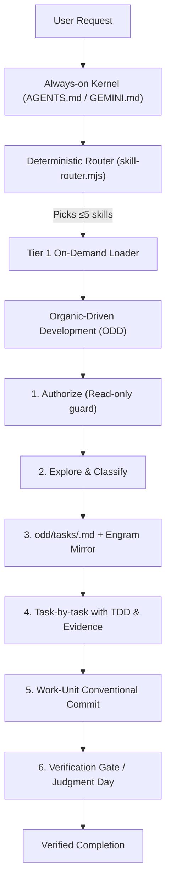

# skillsGV

[](https://github.com/NastaFour/skillsGV/actions)
[](package.json)
[](https://agentskills.io/specification)
[](LICENSE)
[](#package-manager-rules)
[](#categories)
[-brightgreen.svg)](#organic-driven-development)

> **Portable multi-agent skill catalog and process harness** for AI coding assistants. Brings [Gentle-AI](https://github.com/Gentleman-Programming/gentle-ai) 4.3.1 Organic-Driven Development (ODD), dual-judge adversarial review (Judgment Day), persistent memory (Engram), and deterministic keyword routing to **ANY** agent — whether running on cheap flash models or flagship reasoning models.
>
> 🌐 *Para documentación en Español, ver [`README.es.md`](README.es.md).*

---

## 🌟 Why skillsGV?

Most AI coding setups suffer from two extremes:
1. **Monolithic prompt bloat**: stuffing hundreds of rules into `AGENTS.md` or system prompts, burning 15k+ tokens per turn and degrading reasoning on flash models.
2. **Fragmented, undisciplined agents**: agents write uncontrolled code without tests, forget past architectural decisions across sessions, and produce generic "AI-slop" designs.

**skillsGV solves this with a structured, layered harness:**

- 🎯 **244 skills** complying with the open [agentskills.io](https://agentskills.io/specification) standard.
- ⚡ **Two-Tier Progressive Disclosure**: Tier 0 baseline (~2K tokens) + Tier 1 loaded strictly on-demand via deterministic keyword routing (`skill-router`).
- 🔄 **ODD-Exclusive Workflow (Gentle-AI 4.3.1)**: Authorize → Explore → Classify (Understood in ≤1 batch of 3 calls/~10k tokens, Contained risk across 6 items, Resumable from `git diff` alone) → Task File + Engram Mirror → Reviewable Work-Unit Slices (~400 lines; high-risk isolated) on feature branch → Close with `Risk: item N (reason)` or `Risk: none`.
- ⚖️ **Adversarial Verification (Judgment Day)**: Two blind, independent LLM judges review substantive diffs before declaring completion.
- 🎨 **Anti-Slop Design Governance**: Incorporates Paul Bakaus's `impeccable`, Leonxlnx's `taste-skill` (10 Absolute Bans, triaxial dials), and `design-driven` DNA interviews.
- 🧠 **Cross-Session Memory**: Seamless MCP integration with [Engram](https://github.com/Gentleman-Programming/engram) (`mem_save`, `mem_search`, `mem_judge`).
- 🤖 **Universal Agent Portability**: One install script works with Claude Code, Gemini CLI, Cursor, Antigravity, OpenCode, Codex, GitHub Copilot, Windsurf, Kiro, and DeepSeek.

---

## 🚀 Quick Start

### 1. One-Command Install (Recommended)

Install using your preferred agent's native ecosystem:

```bash
# Via Skills CLI (Vercel Labs / skills.sh)
pnpm dlx skills add NastaFour/skillsGV

# In Claude Code / OpenCode / Cursor and other agents: use the manual
# clone & install below. Plugin-marketplace and `gemini extensions`
# commands are NOT available; do not rely on them.
```

### 2. Manual Clone & Install

```bash
# Clone the repository
git clone https://github.com/NastaFour/skillsGV.git
cd skillsGV

# Preview what will be installed across detected tools
node 00-meta-skills/skill-sync/scripts/install-skills.mjs --dry-run

# Install globally for all detected agents
node 00-meta-skills/skill-sync/scripts/install-skills.mjs
```

*Requirements: Node.js 20+ (Pure Node.js `.mjs` scripts — Windows-first, zero native bash dependencies).*

### 3. One-Liner for Any Autonomous Agent

Give this instruction to any AI coding assistant inside your target repository:

```text
Clone https://github.com/NastaFour/skillsGV and run `node install.mjs --target .` — follow its AGENTS.md.
```

In project-level installs, the installer **activates the always-on kernel**:
- Injects `skillsGV:kernel` into the files your harness automatically loads (`AGENTS.md`, `GEMINI.md`, `CLAUDE.md`, or `.github/copilot-instructions.md`).
- Updates `.gitignore` to prevent installed skill folders from ever being committed to your source code repository.
- Generates `.skills-install/manifest.json` for deterministic `--rollback` and `--uninstall`.

---

## 🔄 How It Works: The Layered Architecture



### Feature Comparison

| Capability | Raw Prompting | Generic Skills Repos | skillsGV |
|---|:---:|:---:|:---:|
| **Standardized Skills** | ❌ | ✅ | ✅ (agentskills.io) |
| **Progressive Disclosure** | ❌ | ⚠️ (Manual) | ✅ (Tier 0/1 deterministic routing) |
| **Organic Process (ODD)** | ❌ | ❌ | ✅ (Gentle-AI 4.3.1 alignment) |
| **Dual-Judge Review** | ❌ | ❌ | ✅ (`judgment-day`) |
| **Persistent Memory** | ❌ | ❌ | ✅ (Engram MCP) |
| **Anti-Slop Design System** | ❌ | ❌ | ✅ (`impeccable` + `taste-skill`) |
| **Multi-Agent Roster Switcher** | ❌ | ❌ | ✅ (21 agents across strong/mid/cheap) |
| **Automated Validator** | ❌ | ❌ | ✅ (`validate-skills.mjs --strict`) |

### 📊 Benchmark: With vs Without skillsGV Harness

Offline deterministic benchmark over the core skill suites that ship `evals.json` — `skill-router` routing evals plus expectation checks. The "Without skillsGV" column is a fixed historical reference, never a re-measured arm; every "With skillsGV" figure is computed at runtime by `pnpm benchmark`.

| Metric | Without skillsGV (Historical Baseline) | With skillsGV (Harness) | Measured Delta |
|---|---|---|---|
| **Always-On Context Cost** | ~6,167 tokens (historical monolithic kernel, fixed reference) | current `AGENTS.md` size, measured by `pnpm benchmark` | token reduction computed at runtime |
| **Skill Routing Determinism** | ad-hoc prompt guesswork (not measured) | deterministic `skill-router` evals, results measured by `pnpm benchmark` | routing precision computed at runtime |
| **Evaluated Core Skills** | no offline evals | the core suites shipping `evals.json`, counted at runtime | suite count computed at runtime |
| **Quality & Invariant Checks** | not run | offline expectation checks, pass rate measured by `pnpm benchmark` | pass rate computed at runtime |

Run the benchmark locally:
```bash
pnpm benchmark
```

#### ⚖️ Live A/B Trial: Bare Agent vs Skill Treatment (Measured)

Double-blind randomized A/B trial run across core engineering skills with Gemini Flash on trap-driven engineering benchmarks:

| Arm | Win Rate | Quality Score (1-5) | Protocol & Standards Compliance |
|---|---|---|---|
| **Bare Agent (Control)** | 0% (0/5) | 2.46 | Fell for traps: AI attribution trailers, unapproved runner leaks, no severity taxonomy, premature code generation |
| **With skillsGV (Treatment)** | **100%** (5/5) | **4.72** (+2.26 lift) | Absolute bans respected: pure atomic Conventional Commits, AAA testing with pnpm, 4R review taxonomy, ODD tracking first, Clean Architecture boundaries |
| **Ties** | 0% (0/5) | - | Disambiguated by strict negative constraints |

*Evaluated across 5 trap-driven tasks under double-blind randomized assignment. Run artifact: `evals/results/ab-*.json`.*
View the measured trial summary:
```bash
node scripts/run-evals.mjs --ab-summary
```

---

## 🛠️ CLI Flags & Advanced Installation

The primary installer is `00-meta-skills/skill-sync/scripts/install-skills.mjs`.

| Flag | Description |
|---|---|
| `--target <path>` | Install into a specific project. Omit to install globally across detected tools. |
| `--tool <id>` | Target specific tools: `claude-code`, `opencode`, `cursor`, `copilot`, `codex`, `gemini-cli`, `antigravity`, `kiro`, `windsurf`, `deepseek`, `dsh`. |
| `--all-tools` | Install for all known tools without automatic detection. |
| `--only <list>` | Install specific categories only (e.g. `--only "04-backend,05-frontend"`). |
| `--symlink` | Use directory junctions/symlinks instead of copying (single source of truth). |
| `--dry-run` | Preview actions without touching the filesystem. |
| `--uninstall` | Safely remove catalog files and clean kernel injections using manifest. |
| `--rollback` | Roll back the most recent install generation. |
| `--no-kernel` | Skip kernel injection and `.gitignore` updates. |

### Examples

```bash
# Specific project, targeting Claude Code and Cursor only
node 00-meta-skills/skill-sync/scripts/install-skills.mjs --target "C:\projects\my-app" --tool claude-code --tool cursor

# Only frontend and backend skills via symlinks
node 00-meta-skills/skill-sync/scripts/install-skills.mjs --only "04-backend,05-frontend" --symlink

# Roll back changes if an installation fails
node 00-meta-skills/skill-sync/scripts/install-skills.mjs --rollback
```

---

## 📂 Categories

The catalog contains **244 skills** distributed across structured domains:

| Category | Path | Key Skills & Focus |
|---|---|---|
| **Meta-Skills** | `00-meta-skills/` | `skill-router`, `skill-validator`, `skill-loader`, `skill-creator`, `agent-roster`, `odd-workflow` |
| **Planning & Process** | `01-planning-process/` | `idea-to-prd-express`, `app-flow-spec`, `engram-integration`, `brainstorming`, `tech-escalation-adr` |
| **Dev Roles** | `02-dev-roles/` | `architecture-designer`, `code-reviewer`, `systematic-debugging`, `judgment-day`, `security-audit`, `dod-checker` |
| **AI & MLOps** | `03-ai-ml/` | `ai-orchestration`, `ai-sdk-5`, `llm-integration`, `api-ai-billing`, `prompt-engineering` |
| **Backend** | `04-backend/` | `nodejs`, `expressjs`, `prisma-orm`, `postgresql`, `socketio`, `django-drf`, `spring-boot-3`, `java-21` |
| **Frontend** | `05-frontend/` | `react-19`, `nextjs-15`, `angular-core`, `tailwind-4`, `react-native`, `impeccable`, `taste-skill` |
| **Code Quality** | `06-code-quality/` | `typescript`, `solid-clean-code`, `pnpm-workspaces`, `biome`, `turborepo`, `work-unit-commits` |
| **Testing** | `07-testing/` | `testing-patterns` (TDD RED/GREEN), `playwright`, `pytest`, `go-testing` |
| **DevOps** | `08-devops/` | `ci-cd`, `observability`, `monitoring`, `kill-switches`, `store-deployment-eas` |
| **Media & Graphics** | `09-media-graphics/` | `nano-banana`, `banana-claude` |
| **MCP Hybrids** | `11-mcp-hybrid/` | `component-scrapper-mcp`, `figma-mcp`, `oklch-theme-injector`, `open-design`, `openseo` |
| **Matt Pocock Suite** | `12-matt-pocock/` | `ask-matt`, `domain-modeling`, `grilling`, `scaffold-exercises`, `tdd`, `writing-for-agents` |

---

## 🤖 Agent Roster & Multi-Model Switching

Manage model assignments across all **21 agents** in the ecosystem (`strong`, `mid`, `cheap` tiers) with zero vendor lock-in:

```powershell
# Preview provider changes without applying
node 00-meta-skills/agent-roster/scripts/set-models.mjs --profile glm --dry-run

# Switch all 21 agents to GLM profile
node 00-meta-skills/agent-roster/scripts/set-models.mjs --profile glm --apply

# Set individual tiers dynamically
node 00-meta-skills/agent-roster/scripts/set-models.mjs --strong opencode-go/glm-5.3 --apply
node 00-meta-skills/agent-roster/scripts/set-models.mjs --mid opencode-go/glm-5.2 --apply
node 00-meta-skills/agent-roster/scripts/set-models.mjs --cheap opencode-go/glm-5.2 --apply
```

---

## 🔒 Package Manager Rules

> ⚠️ **pnpm only — `npm` and `npx` are rejected.**
>
> All scripts and commands require `pnpm` (and `pnpm dlx` in place of `npx`). The strict mechanical validator fails if `npm` or `npx` appears in skill instructions unless justified via `allows-npm: <reason>` in frontmatter.

---

## 🧪 Testing & Validation

Run the complete offline test and validation suite:

```bash
# Run all unit tests (112+ tests)
pnpm test

# Strict mechanical specification validation (0 errors, 0 warnings required)
pnpm validate:strict

# Catalog health check
pnpm doctor

# Benchmark / telemetry status
node 00-meta-skills/skill-loader/scripts/skills-loader.mjs --status
```

---

## 📜 Credits & Attributions

This repository synthesizes, adapts, and organizes open-source standards and methodologies from exceptional engineers across the tech community:

- **[Gentleman Programming](https://github.com/Gentleman-Programming)**: ODD process harness, Engram persistent memory, Judgment Day protocol, 21-agent roster, GGA pre-commit verification.
- **[Anthropic](https://github.com/anthropics/skills)**: Core Agent Skills patterns, directory structure, and foundational prompts.
- **[Vercel Labs](https://github.com/vercel-labs/agent-skills)**: React/Next.js composition and performance patterns.
- **[Matt Pocock](https://github.com/mattpocock)**: The 23 engineering skills in `12-matt-pocock/`.
- **[Paul Bakaus](https://github.com/pbakaus/impeccable)**: Impeccable design system governance (Apache-2.0).
- **[Leonxlnx](https://github.com/Leonxlnx/taste-skill)**: Taste-skill anti-slop aesthetic dial system (MIT).
- **[Corey Haines](https://coreyhaines.com/)**: CRO and conversion funnels.
- **[Adam Wathan & Steve Schoger](https://www.refactoringui.com/)**: Refactoring UI visual design rules.
- **[Emil Kowalski](https://animations.dev/)**: Physics-based animations and fluid micro-interactions.
- **[Donald Miller](https://storybrand.com/)**: StoryBrand SB7 narrative architecture.
- **[Jesse Vincent](https://github.com/obra/superpowers)**: Superpowers agent capabilities concepts.

### License

The integration glue-code, installation tooling, mechanical validators, and adapted skill manifests are licensed under the **MIT License**. Original works retain their respective licenses cited above.
